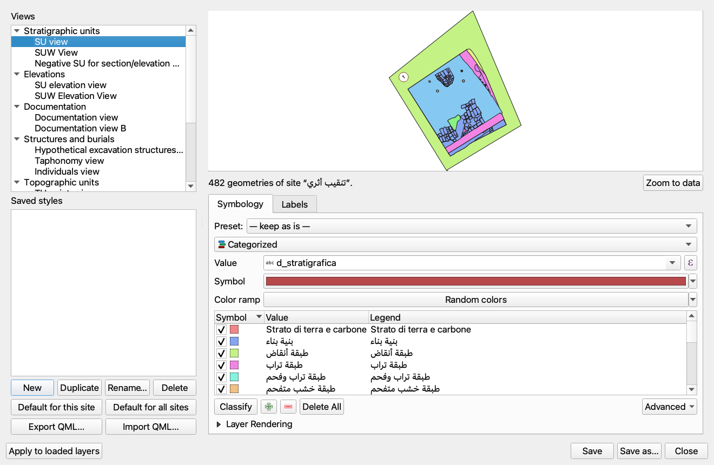

# الدرس 14: نظم المعلومات الجغرافية والخرائط

## المقدمة

PyArchInit متكامل بعمق مع **QGIS**، مستفيداً من جميع وظائف GIS لإدارة البيانات الأثرية مكانياً. يغطي هذا الدرس التكامل الخرائطي، والطبقات المُعدة مسبقاً، والوظائف المتقدمة مثل **التجزئة التلقائية SAM**.

### وظائف GIS الرئيسية

- عرض الوحدات الطبقية على الخريطة
- طبقات متجهة مُعدة مسبقاً
- تنسيق QML مخصص
- الارتفاعات والقياسات GIS
- التجزئة التلقائية (SAM)
- تصدير الخرائط

## طبقات PyArchInit المُعدة مسبقاً

### الطبقات المتجهة الرئيسية

| الطبقة | الهندسة | الوصف |
|--------|---------|-------|
| `pyunitastratigrafiche` | MultiPolygon | وحدات طبقية ترسب |
| `pyunitastratigrafiche_usm` | MultiPolygon | وحدات طبقية جدارية |
| `pyarchinit_quote` | Point | نقاط الارتفاع |
| `pyarchinit_siti` | Point | مواقع المواقع الأثرية |
| `pyarchinit_ripartizioni_spaziali` | Polygon | مناطق الحفر |
| `pyarchinit_strutture_ipotesi` | Polygon | هياكل مفترضة |
| `pyarchinit_documentazione` | Point | مراجع التوثيق |

### سمات طبقة الوحدات الطبقية

| الحقل | النوع | الوصف |
|-------|-------|-------|
| `gid` | Integer | معرف فريد |
| `scavo_s` | Text | اسم الموقع |
| `area_s` | Text | رقم المنطقة |
| `us_s` | Text | رقم الوحدة الطبقية |
| `stratigraph_index_us` | Integer | الفهرس الطبقي |
| `tipo_us_s` | Text | نوع الوحدة |
| `rilievo_originale` | Text | المرفوع الأصلي |
| `disegnatore` | Text | مؤلف المرفوع |
| `data` | Date | تاريخ المرفوع |

## عرض الوحدات الطبقية على الخريطة

### من تبويب "الخريطة" في بطاقة الوحدة الطبقية

1. فتح بطاقة الوحدة الطبقية
2. اختيار تبويب **الخريطة**
3. الوظائف المتاحة:

| الزر | الوظيفة |
|------|---------|
| عرض الوحدة | عرض الوحدة الحالية على الخريطة |
| عرض الكل | عرض جميع وحدات المنطقة |
| سجل جديد | إنشاء هندسة جديدة |
| توسيط | توسيط الخريطة على الوحدة |

### العرض من البحث

1. تنفيذ بحث عن الوحدات
2. زر **"عرض السجل"** ← يعرض وحدة مفردة
3. زر **"عرض الكل"** ← يعرض جميع النتائج

### اختيار النمط (الوحدات الطبقية وUSM)

منذ الإصدار **5.13.112-alpha** لا تظهر النافذة **Style Choice** الموصوفة أدناه **إلا إذا لم يكن للعرض أي نمط افتراضي محفوظ**: فمع وجود نمط افتراضي (للموقع أو لجميع المواقع) تحمّل البطاقة العرض وتطبّق ذلك النمط ولا تسأل عن شيء. وتُنشأ الأنماط الافتراضية في النافذة **View styles** (انظر القسم «أنماط العروض» أدناه).

عند تحميل الوحدات الطبقية أو الوحدات الطبقية الجدارية (USM) من نتائج البحث على الخريطة، تظهر نافذة **Style Choice** ("How do you want to manage the layer style?"). تظهر الأزرار باللغة الإنجليزية:

| الزر | التأثير |
|------|---------|
| **Save new style** | ينشئ النمط بناءً على الحقل المختار ويحفظه في قاعدة البيانات باسم |
| **Load existing style** | يستخدم نمطاً جاهزاً يُختار من قائمة (انظر أدناه) كقالب، وينشئ النمط بناءً على الحقل المختار دون حفظه في قاعدة البيانات |
| **Use temporary style** | ينشئ النمط بناءً على الحقل المختار دون حفظه في قاعدة البيانات |
| **Single symbol (outline only)** | يرسم حدود الأشكال الهندسية فقط، دون تعبئة |

منذ الإصدار 5.13.19-alpha يفتح **Load existing style** نافذة **Existing style** ("Choose the style to use as a template:"، باللغة الإنجليزية) مع قائمة الأنماط المتاحة: الأنماط المحفوظة في قاعدة البيانات (*Database: الاسم*)، وأنماط QML المرفقة مع pyArchInit (`us_*.qml`، وتظهر باسم *pyArchInit: …*)، و**Other QML file…** لاختيار أي ملف `.qml`. يُحمَّل النمط المختار على الطبقة (وتأتي معه الشفافية ووضع الدمج، أما التسميات فلا: ففي طبقات عرض US وUSM المضلعة هي، منذ الإصدار 5.13.110-alpha، تسميات الفقرة **التسميات** أدناه، أي رقم الوحدة داخل دائرة، أياً كان ما يقوله النمط القالب) ويُستخدم **قالباً**: بعد اختيار حقل التصنيف، تحتفظ القيم الموجودة أصلاً في النمط بلونها ورمزها، وتحصل القيم الأخرى على نسخة من رمزه بلون خاص بها. وإذا أُلغي الاختيار يعمل مثل **Use temporary style**. في السابق كان يبحث فقط بين أنماط قاعدة البيانات، وإذا لم يجد أياً منها ينتقل مباشرة إلى نافذة التصنيف.

مع **Save new style** و**Load existing style** و**Use temporary style** يتم بعد ذلك اختيار حقل التصنيف (نافذة **اختر حقل التصنيف**): **التعريف الطبقي** أو **نوع الوحدة** أو **التعريف التفسيري** أو **الفترة/المرحلة (cont_per)** (منذ الإصدار 5.13.19-alpha)؛ ويحصل كل قيمة من قيم الحقل على لون خاص بها، ومنذ الإصدار 5.13.19-alpha يبقى هذا اللون نفسه في كل مرة تُحمَّل فيها الطبقة. ومع **الفترة/المرحلة (cont_per)** يعرض عنصر وسيلة الإيضاح لكل رمز أيضاً تأريخ الفترة/المرحلة المأخوذ من التحقيب الزمني. تظهر فقط الحقول الموجودة في الطبقة.

**ترتيب الرسم.** منذ الإصدار 5.13.19-alpha تُرسم الوحدات بالترتيب الذي يستخدمه مدير الزمن (Time Manager): أولاً الوحدات التي ليس لها فترة، ثم حسب التسلسل الزمني للفترة (من التحقيب الزمني للفترة/المرحلة الأولية للوحدة الطبقية، أو من `cont_per`)، ثم حسب `order_layer` (0 = الأقدم)، وأخيراً القطع فوق ردمه، بحيث تكون الوحدات الأحدث في الأعلى. ينطبق ذلك على جميع خيارات النمط، بما في ذلك **Single symbol (outline only)**. وعند تحميل الطبقات فترةً فترة، يُطلب النمط مرة واحدة فقط ويُستخدم لجميع الفترات. منذ الإصدار 5.13.114-alpha تُرتَّب أيضاً **وسيلة الإيضاح** الخاصة بالطبقة في لوحة الطبقات في QGIS من الأحدث إلى الأقدم — أي، بالنسبة إلى الفئات حسب الفترة، سنة البداية من التحقيب الزمني، ثم `order_layer`، وكلاهما بترتيب تنازلي — وهكذا، عند إزالة علامات الاختيار عن العناصر ابتداءً من الأعلى، ينكشف ما تحتها.

**التسميات.** منذ الإصدار 5.13.110-alpha، تتلقى طبقة عرض US (وUSM) مع النمط المختار **تسمياتها** أيضًا: رقم الوحدة **بخط غليظ داخل دائرة بيضاء بحدٍّ أحمر داكن**، **تسمية واحدة لكل وحدة**، على أكبر رسم لها إن كان ظاهرًا (غير مغطّى بالكامل برسم أعلى مستوى)، وبالوصفة نفسها المتبعة في لوحات أطلس Time Manager (الدرس 25). وحين يتداخل رقمان يُنقل أحدهما ويصله خط إحالة برسمه. ينطبق ذلك على الوحدات الطبقية وUSM، مع SQLite وPostgreSQL، وعلى جميع خيارات النمط بما فيها **Single symbol (outline only)**؛ وإذا كان النمط المحمَّل بـ **Load existing style** يحمل تسميات أصلًا، فإن الرقم داخل الدائرة يحل محلها. أما طبقات النقاط فلا تتلقى الرقم داخل الدائرة. لكن منذ الإصدار 5.13.111-alpha يتلقى **عرض الارتفاعات** (نقاط الارتفاع، الطبقة «Elevation view»)، فور تحميله من بطاقة الوحدة الطبقية، **تسمية بقيمة الارتفاع** (بمنزلتين عشريتين، مثل «12.35») موضوعة **فوق الخط الأفقي للرمز**، وبالوصفة نفسها المتبعة في لوحات أطلس Time Manager. وينطبق ذلك على جميع الأوامر التي تحمّله، مع SQLite وPostgreSQL، ولا يتوقف على النمط المختار؛ أما الطبقات التي ليست نقاطًا، أو التي لا تحتوي على حقل الارتفاع، فلا تتلقى هذه التسمية. منذ الإصدار 5.13.112-alpha صار الرقم داخل الدائرة والارتفاع هما **الـ preset الابتدائي** للتسميات: ففي تبويب **التسميات** (*Labels*) من النافذة **View styles** (انظر القسم الذي يحمل الاسم نفسه أدناه) يمكن تغييرهما وحفظهما نمطًا افتراضيًا يحل محلهما عند التحميل.

منذ الإصدار 5.13.18-alpha أصبح النمط المختار (وحقل التصنيف) يُحترم أيضاً مع قواعد بيانات SQLite، سواء للوحدات الطبقية أو للوحدات USM؛ وقبل ذلك كانت الخريطة تظهر دائماً بلون واحد لكل وحدة طبقية.

## أنماط العروض

منذ الإصدار **5.13.112-alpha** تتيح نافذة واحدة، **View styles** (أنماط العروض)، تكوين نمط كل عرض من عروض pyArchInit — **الترميز والتسميات** —: عروض الوحدات الطبقية (US) والجدارية (USM)، والارتفاعات، والتوثيق، والهياكل والقبور، والوحدات الطبوغرافية (UT)، والمواقع، واللقى، والمقاطع. يظهر النمط فورًا على **معاينة** ببيانات الموقع، ويُحفظ باسم في قاعدة البيانات، ويمكن جعله **افتراضيًا** لموقع واحد أو لجميع المواقع: ومنذ تلك اللحظة تطبّقه البطاقات التي تحمّل العرض من تلقاء نفسها دون أن تسأل عن شيء.

<!-- IMMAGINE: لقطة شاشة لنافذة «View styles»: عمود قائمة العروض والأنماط المحفوظة مع أزرارها، وعمود المعاينة وتبويبا Symbology وLabels، وفي الأسفل Apply to loaded layers وSave وSave as… وClose -->

*الشكل 1: نافذة «View styles»*

نصوص النافذة موجودة بالإيطالية والإنجليزية فقط: عندما يكون QGIS بالعربية تظهر بالإنجليزية. فيما يلي تأتي بعد كل تسمية مترجمة التسمية الإنجليزية بين قوسين؛ والأمر نفسه ينطبق على بند القائمة: فهو يسمى «View styles…» عندما يكون QGIS بالعربية.

### من أين تُفتح

النافذة غير نمطية (non-modal): تبقى مفتوحة أثناء العمل على الخريطة. وتُفتح بأربع طرق.

- **من شريط أدوات pyArchInit** (منذ الإصدار 5.13.113-alpha): **الزر الرابع**، بأيقونة لوحة الألوان، بعد زر GPT مباشرة («AI Query Database»). إذا كانت الطبقة النشطة عرضًا من عروض pyArchInit فتُفتح النافذة مباشرة على ذلك العرض، وإلا فعلى عرض US.
- **من قائمة الإضافة**: **Plugins → pyArchInit - Archaeological GIS Tools → View styles…** (أنماط العروض؛ يسمى البند «Stili delle viste…» عندما يكون QGIS بالإيطالية). إذا كانت الطبقة النشطة عرضًا من عروض pyArchInit فتُفتح النافذة مباشرة على ذلك العرض، وإلا فعلى عرض US.
- **من قائمة الطبقة**: انقر بزر الفأرة الأيمن على طبقة متجهة في لوحة الطبقات في QGIS ← **View styles…**. إنه البند نفسه، بالاسم نفسه وبالقاعدة نفسها: إذا كانت الطبقة عرضًا من عروض pyArchInit فتُفتح النافذة مباشرة عليه.
- **من بطاقة US**: الزر **Style…** (**Stile…** عندما يكون QGIS بالإيطالية)، بجانب الزر الذي يحمّل الطبقات. يفتح النافذة على عرض US، بموقع البطاقة.

تعرض المعاينة هندسات **موقع** واحد: موقع البطاقة إذا فُتحت النافذة من الزر «Style…»، وإلا فـ**الموقع النشط** المحدد في إعدادات pyArchInit (الدرس 01). وإذا لم يكن هناك موقع نشط عُرضت جميع المواقع.

### العروض والأنماط المحفوظة

يحتوي العمود الخاص بالعروض على قائمتين.

**العروض** (*Views*). عروض pyArchInit، في مجموعات:

| المجموعة | العروض |
|----------|--------|
| «الوحدات الطبقية» (*Stratigraphic units*) | US وUSM وUS السالبة |
| «الارتفاعات» (*Elevations*) | ارتفاعات US وارتفاعات USM |
| «التوثيق» (*Documentation*) | التوثيق (عرضان) |
| «الهياكل والقبور» (*Structures and burials*) | الهياكل والقبور والأفراد |
| «الوحدات الطبوغرافية» (*Topographic units*) | UT نقطية وخطية ومضلعية |
| «المواقع» (*Sites*) | مواقع نقطية ومواقع مضلعية |
| «اللقى» (*Finds*) | اللقى |
| «المقاطع» (*Sections*) | مقاطع الحفر |

حتى العروض التي كانت تُحمَّل حتى الآن بلا نمط (التوثيق، والهياكل والقبور، وUT، والمواقع، واللقى، والمقاطع) صار لها هنا نمطها. والعرض غير الموجود في قاعدة البيانات يصير **رماديًا** عند اختياره، ويكتب سطر الحالة «العرض غير موجود في قاعدة البيانات هذه» (*View not present in this database.*).

**الأنماط المحفوظة** (*Saved styles*). تحتها الأنماط المحفوظة للعرض المختار، نمط في كل سطر: *الاسم · الموقع (أو «جميع المواقع») · «✓ افتراضي»* (*all sites*، *✓ default*). النقر على نمط يحمّله في المعاينة وفي التبويبين لمشاهدته أو تعديله تعديلًا طفيفًا. أما الأنماط التي حفظها QGIS في قاعدة البيانات لتلك الطبقة فتظهر على صورة *الاسم · محفوظ بواسطة QGIS* (*Saved with QGIS*): يمكن تحميلها لكن pyArchInit لا يعيد كتابتها؛ وللاحتفاظ بنسخة منها بين أنماطه الخاصة يُستعمل **حفظ باسم…** (*Save as…*). الأزرار تحت القائمة:

| الزر | ما يفعله |
|------|----------|
| **جديد** (*New*) | يبدأ من نمط يُراد تكوينه: حدود فقط، مع تسميات البداية الخاصة بالعرض. ويُطلب الاسم عند أول **حفظ** (*Save*) |
| **تكرار** (*Duplicate*) | ينسخ النمط المختار باسم «… (2)»؛ والنسخة ليست افتراضية |
| **إعادة تسمية…** (*Rename…*) | يغيّر اسم النمط المختار |
| **حذف** (*Delete*) | يحذف النمط المختار بعد تأكيد |
| **افتراضي لهذا الموقع** (*Default for this site*) | يصير النمط المختار هو المطبَّق عند تحميل العرض للموقع الحالي (إذا كان النمط من «جميع المواقع» فإنه ينشئ نسخة منه للموقع الحالي ويجعل النسخة هي الافتراضية؛ ويبقى الأصل كما هو) |
| **افتراضي لجميع المواقع** (*Default for all sites*) | يصير هو المطبَّق على المواقع التي ليس لها نمط افتراضي خاص بها (إذا كان النمط تابعًا لموقع فإنه ينشئ نسخة منه لجميع المواقع ويجعل النسخة هي الافتراضية؛ ويبقى الأصل كما هو) |
| **تصدير QML…** (*Export QML…*)، **استيراد QML…** (*Import QML…*) | انظر «التصدير والاستيراد» |

لكل عرض نمط افتراضي واحد فقط لكل موقع، وآخر واحد فقط لجميع المواقع: وعندما يصير نمط آخر افتراضيًا تُزال العلامة «✓ افتراضي» عن النمط السابق. تعمل أزرار التكرار وإعادة التسمية والحذف والزرّان «افتراضي» على النمط المختار في القائمة؛ وإذا لم يُختر أي نمط يظهر التنبيه «اختر أولًا نمطًا محفوظًا» (*Choose a saved style first.*).

### المعاينة والترميز والتسميات

**المعاينة.** في أعلى عمود المعاينة خريطة تعرض العرض المختار، مقروءًا من قاعدة البيانات ومصفّى على الموقع الحالي: وكل تغيير في النمط يظهر فورًا. ويقود الزر **تقريب إلى البيانات** (*Zoom to data*) الخريطة إلى جميع الهندسات. ويذكر سطر الحالة تحت الخريطة عددها (*482 هندسة للموقع «Scavo 2026».*، *482 geometries of site “Scavo 2026”.*) أو، إذا لم يكن للموقع أي هندسة في ذلك العرض، «لا توجد هندسات للموقع الحالي» (*No geometry for the current site.*): ويمكن تكوين النمط على الرغم من ذلك. والمعاينة طبقة مستقلة **لا تُضاف إلى المشروع**: فطبقات مشروع QGIS لا تتغير ما لم يُضغط **تطبيق على الطبقات المحمّلة** (*Apply to loaded layers*). وعند اختيار عرض تبدأ المعاينة مما كان pyArchInit سيطبّقه عليه في تلك اللحظة عند التحميل (انظر «الأنماط الافتراضية والتحميل»).

تحت الخريطة تبويبان: **الترميز** (*Symbology*) و**التسميات** (*Labels*).

**تبويب الترميز.** في الأعلى القائمة المنسدلة **Preset** (*Preset:*):

| Preset | الأثر |
|--------|-------|
| «— اتركه كما هو —» (*— keep as is —*) | لا يغيّر شيئًا |
| «حدود فقط» (*Outline only*) | مضلعات بلا تعبئة وبحدٍّ رمادي داكن، وخطوط رفيعة، ونقاط على شكل دوائر فارغة |
| «النمط المرفق مع pyArchInit» (*Style shipped with pyArchInit*) | ملف QML المرافق للإضافة: موجود لعروض US وUSM وللارتفاعات |
| «فئات حسب “الحقل”» (*Categories by “field”*) | فئة بلونها الخاص لكل قيمة من قيم الحقل. وهناك بند لكل حقل من الحقول المناسبة لذلك العرض والتي تملكها الطبقة: للوحدات `d_stratigrafica` و`tipo_us_s` و`d_interpretativa` و`cont_per`؛ وللعروض الأخرى مثلًا `tipo_doc` أو `tipologia_struttura` أو `tipo_reperto` |

تحت القائمة **محرّر الترميز في QGIS**، وهو نفسه الموجود في خصائص الطبقة (رمز واحد، مصنّف، متدرّج، قائم على القواعد…): الـ preset نقطة البداية ومنه يُعدَّل كل شيء؛ وكل تغيير يظهر فورًا في المعاينة.

**تبويب التسميات.**

| عنصر التحكم | ما يفعله |
|-------------|----------|
| **التسميات مفعّلة** (*Labels on*) | يشغّل تسميات العرض ويوقفها |
| **ما يُكتب** (*What to write:*) | «بلا تسمية» (*No label*)؛ «رقم الوحدة داخل دائرة» (*Unit number in a circle*: الرقم بخط غليظ داخل دائرة بيضاء بحدٍّ أحمر داكن، كما في لوحات أطلس Time Manager، الدرس 25)؛ «الارتفاع فوق الرمز» (*Elevation above the symbol*: قيمة الارتفاع فوق الخط الأفقي للرمز)؛ «حقل أو تعبير» (*A field or an expression*) |
| **الحقل** (*Field:*)، **التعبير** (*Expression:*) | للبند الأخير: حقل العرض المراد كتابته أو تعبير QGIS (وإذا كُتب تعبير فله الأسبقية على الحقل) |
| **الموضع** (*Placement:*)، **الإزاحة (مم)** (*Offset (mm):*) | للبند الأخير: «في الوسط» (*Centred*) أو «حول النقطة» (*Around the point*) أو «فوق الرمز» (*Above the symbol*)؛ وترفع الإزاحة التسمية بهذا العدد من الملّيمترات وتسري على «فوق الرمز» |
| **تسمية واحدة لكل وحدة (على أكبر رسم ظاهر)** (*One label per unit (on the largest visible drawing)*) | لرقم الوحدة: تسمية واحدة فقط لكل وحدة، على أكبر رسم لها يظهر (غير مغطّى بالكامل برسم أعلى مستوى)؛ وعند إيقافها يكون لكل رسم تسميته |
| **الخط والخلفية** (*Font and background*) | الخط، و**الحجم (مم)** (*Size (mm):*)، و**غليظ** (*Bold*)، و**اللون…** (*Colour…*) للنص، و**هالة بيضاء** (*White buffer*)، و**خلفية دائرية** (*Circle background*) مع **التعبئة…** (*Fill…*) و**الحد…** (*Stroke…*) |

رقم الوحدة داخل دائرة هو الـ preset الابتدائي لعروض US وUSM، والارتفاع فوق الرمز هو الابتدائي لعروض الارتفاعات: وهما تسميات فقرة **التسميات** في «اختيار النمط (الوحدات الطبقية وUSM)» (أعلاه)، ويمكن تغييرهما هنا. أما العروض الأخرى فلا تسميات لها في البداية. واللوحة هي لوحة pyArchInit، وهي أبسط من محرر التسميات في QGIS (القائم على القواعد وغيره)، الذي لا يمكن فتحه خارج خصائص الطبقة.

### الأنماط الافتراضية والتحميل

في الأسفل أربعة أزرار:

| الزر | ما يفعله |
|------|----------|
| **تطبيق على الطبقات المحمّلة** (*Apply to loaded layers*) | يطبّق النمط الظاهر في المعاينة — الترميز والتسميات — على طبقات مشروع QGIS التي تأتي من ذلك العرض؛ ويكتب سطر الحالة «طُبّق النمط على N طبقة من المشروع» (*Style applied to N project layers.*) أو «لا توجد في المشروع أي طبقة من هذا العرض» (*No layer of this view in the project.*). ولا يحفظ شيئًا في قاعدة البيانات |
| **حفظ** (*Save*) | يحفظ على النمط الحالي (المختار في القائمة)؛ وإذا لم يوجد أي نمط يطلب اسمًا وينشئ نمطًا جديدًا |
| **حفظ باسم…** (*Save as…*) | يطلب اسمًا ويحفظ نمطًا جديدًا لجميع المواقع: «حُفظ النمط “الاسم”» (*Style “name” saved.*) |
| **إغلاق** (*Close*) | يغلق النافذة |

ولكي يصير نمط ما هو الذي يظهر عند كل تحميل: (1) اختر العرض؛ (2) كوّن الترميز والتسميات وأنت تراقب المعاينة؛ (3) **حفظ باسم…** مع اسم؛ (4) **افتراضي لهذا الموقع** أو **افتراضي لجميع المواقع**؛ (5) وإذا كانت الطبقات موجودة في المشروع أصلًا فاضغط **تطبيق على الطبقات المحمّلة**.

**عند التحميل تكون الكلمة للنمط الافتراضي.** حين تحمّل بطاقة من بطاقات pyArchInit (مثل بطاقة US) عرضًا، فإنها تطبّق بالترتيب:

1. **النمط الافتراضي للموقع الذي يُحمَّل العرض من أجله** (إن وُجد): تمرّر بطاقة US موقع البطاقة، وتمرّر المحمِّلات حسب الفترة (Time Manager) الموقع الذي ترسمه؛ وحيث لا يعرف المحمِّل الموقع يسري الموقع النشط في إعدادات pyArchInit (الدرس 01)؛
2. وإلا **النمط الافتراضي لجميع المواقع**؛
3. وإلا، بالنسبة إلى عروض US وUSM والارتفاعات، النمط المرفق مع pyArchInit مع الرقم داخل الدائرة أو الارتفاع فوق الرمز (كما منذ الإصدارين 5.13.110-alpha و5.13.111-alpha)؛ وتُحمَّل العروض الأخرى كما كانت، بلا نمط.

لا تظهر النافذة ذات الخطوات الثلاث **Style Choice** (فقرة «اختيار النمط (الوحدات الطبقية وUSM)»، أعلاه) **إلا إذا لم يوجد للعرض أي نمط افتراضي محفوظ**؛ ومع وجود نمط افتراضي تكتفي بطاقة US بالتحميل، ولا يستبدله نمط يُختار يدويًا. و«تسمية واحدة لكل وحدة» تُحسب من جديد عند كل تحميل، على رسومات المرشّح في تلك اللحظة: فهي لا تتوقف على المرشّح الذي حُفظ به النمط. كما يحترم تبويب **Map preview** في بطاقة US النمط الافتراضي المحفوظ (مع SQLite منذ الإصدار 5.13.113-alpha، وكان يعطي خطأً قبل ذلك؛ ومع PostgreSQL منذ الإصدار 5.13.112-alpha بالفعل)؛ وإذا لم يوجد نمط افتراضي فإنه يعرض كما في السابق ترميزه التلقائي، وتبقى المضلعات هناك أيضًا بالترتيب الطبقي.

**ترتيب الرسم هو دائمًا الترتيب الطبقي** (منذ الإصدار 5.13.113-alpha). في عروض الوحدات (US وUSM وUS السالبة) تُرسم المضلعات من الوحدة الأقدم، في الأسفل، إلى الأحدث، في الأعلى: أولاً حسب تسلسل الفترات الزمني إذا أمكن قراءة التحقيب الزمني للموقع (بدءًا بالوحدات التي ليس لها فترة)، ثم حسب `order_layer` تصاعديًا (0 = الأقدم، وتُرسم أولاً)، ثم حسب الفهرس الطبقي، كما في Time Manager (الدرس 25). وينطبق ذلك أيًّا كان النمط — النمط الافتراضي المحفوظ، أو ملف QML المرفق، أو ملف QML مستورد، أو النمط المركّب في المعاينة — وكذلك في **تطبيق على الطبقات المحمّلة** (*Apply to loaded layers*) وفي معاينة النافذة. وهكذا، عند إزالة علامة الاختيار عن فئة في وسيلة الإيضاح في QGIS، يظهر ما تحتها. أما العروض الأخرى (الارتفاعات، التوثيق، الهياكل…) فلا تأخذ أي ترتيب.

### التصدير والاستيراد

- **تصدير QML…** يكتب في ملف `.qml` النمط كما يظهر في المعاينة — الترميز والتسميات —؛ والاسم المقترح هو اسم العرض (مثل `pyarchinit_us_view.qml`). وهو يفيد في الاحتفاظ بنسخة أو في استعمال النمط في قاعدة بيانات أخرى أو في QGIS.
- **استيراد QML…** يقرأ ملف `.qml` ويعرضه في المعاينة ويحفظه نمطًا جديدًا لجميع المواقع باسم الملف. وإذا لم يُقرأ الملف على أنه QML ظهر تنبيه يذكر ذلك مع اسم الملف (*“name.qml” does not read as QML.*) ولا يُكتب شيء.
- تعيش الأنماط المحفوظة في **قاعدة البيانات المتصلة** بـ pyArchInit، في الجدول `pyarchinit_view_styles` الذي يُنشأ من تلقاء نفسه، مع SQLite ومع PostgreSQL: ومع PostgreSQL يراها جميع مستخدمي قاعدة البيانات نفسها. ولنقلها إلى قاعدة بيانات أخرى تُصدَّر وتُستورَد بصيغة QML.
- إذا لم تكن قاعدة البيانات متصلة (أو تعذّر إنشاء جدول الأنماط، مثلًا على PostgreSQL بلا صلاحية إنشاء الجداول) فإن الأنماط المحفوظة غير متاحة ولا يمكن إلا التصدير: ويذكر ذلك سطر الحالة تحت المعاينة بعد عدد الهندسات، بالعبارة «قاعدة البيانات غير متصلة: يمكن تصدير الأنماط فقط» (*Database not connected: styles can only be exported.*) أو «لا يمكن إنشاء جدول الأنماط في قاعدة البيانات هذه: يمكن تصدير الأنماط فقط» (*The styles table cannot be created in this database: styles can only be exported.*).

## تنسيق الطبقات

### ملفات QML

يتضمن PyArchInit أنماطاً مُعدة مسبقاً بصيغة QML:
```
pyarchinit/styles/
├── pyunitastratigrafiche.qml
├── pyunitastratigrafiche_usm.qml
├── pyarchinit_quote.qml
└── ...
```

### تطبيق النمط

1. اختيار الطبقة في المفتاح
2. النقر بالزر الأيمن ← **الخصائص**
3. تبويب **النمط**
4. **تحميل نمط** ← اختيار QML

### التخصيص

يمكن تخصيص الأنماط لـ:
- الألوان حسب نوع الوحدة
- التسميات برقم الوحدة
- الشفافية
- الحدود والتعبئات

## الارتفاعات والقياسات

### طبقة الارتفاعات

تخزن طبقة `pyarchinit_quote`:
- الإحداثيات X، Y
- الارتفاع Z (المطلق)
- نوع نقطة الارتفاع
- الوحدة الطبقية المرجعية
- المنطقة المرجعية

### حساب الارتفاعات التلقائي

من بطاقة الوحدة الطبقية، تُحسب الارتفاعات الدنيا/القصوى:
1. استعلام نقاط الارتفاع المرتبطة بالوحدة
2. استخراج القيمة الدنيا والقصوى
3. العرض في التقرير

### إدخال الارتفاعات

1. طبقة الارتفاعات في وضع التحرير
2. رسم نقطة على الخريطة
3. ملء السمات:
   - `sito_q`
   - `area_q`
   - `us_q`
   - `quota`
   - `unita_misura_q`

## التجزئة التلقائية SAM

### ما هو SAM؟

**SAM (Segment Anything Model)** هو نموذج الذكاء الاصطناعي من Meta الذي يقسّم الصورة إلى الكائنات التي تحتويها. في PyArchInit تحوّل نافذة SAM الصورة إلى **مضلعات**، انطلاقاً من:

- **صورة جوية متعامدة** (أورثوفوتو، أي ملف راستر: GeoTIFF، أو JPEG مُرجع جغرافياً…)؛
- أو **طبقة بلاطات (tiles) أو خدمة** محمّلة في QGIS: XYZ مثل ESRI World Imagery أو Google، وWMS، وArcGIS REST.

ليس الحجارة فقط: بل أيضاً **المباني والطرق والحقول والأنهار والجدران**. النماذج من عائلتين:

- **SAM 2.1** (Meta) يجد حدود الكائنات — كلها، أو تلك التي تشير إليها بنقاط أو بمربع أو بمضلع — لكنه لا يقول ما هي؛
- **الفئات النصية** (YOLOE-26 محلياً، وSAM 3 في السحابة) تبحث عمّا تكتبه («building, road, river, field») ويحمل كل مضلع تسميته.

تذهب المضلعات إلى الطبقة التي تختارها: طبقات الوحدات الطبقية في PyArchInit، أو أي طبقة مضلعات في المشروع، أو طبقة مؤقتة جديدة.

### الوصول إلى الوظيفة

1. من شريط أدوات PyArchInit: الزر المنسدل **أدوات التحليل** (Analysis Tools) ← «SAM - Segmentation (stones, buildings, roads, fields…)». إنه الإجراء الافتراضي للزر: نقرة على الأيقونة تفتح النافذة مباشرة.
2. أو من قائمة **pyArchInit** ← «SAM - Segmentation (stones, buildings, roads, fields…)».

عنوان النافذة «SAM — Segmentation (stones, buildings, roads, fields, rivers…)». تسمياتها موجودة بالإيطالية والإنجليزية فقط: عندما يكون QGIS بالعربية تظهر بالإنجليزية، كما في المخطط. فيما يلي تأتي بعد كل تسمية مترجمة التسمية الإنجليزية بين قوسين.

### واجهة SAM

```
┌────────────────────────────────────────────────────────────────────┐
│ SAM — Segmentation (stones, buildings, roads, fields, rivers…)     │
├────────────────────────────────────────────────────────────────────┤
│ Automatic segmentation — from an orthophoto or a tile layer        │
│ (ESRI, Google, WMS) to polygons, with SAM 2.1 (Meta) or with text  │
│ classes.                                                           │
├─ Local environment ────────────────────────────────────────────────┤
│ ready — ultralytics 8.4.x, torch 2.x, mps                          │
│                                     [Install / update]  [Show log] │
├─ Image ────────────────────────────────────────────────────────────┤
│ Raster layer: [orthophoto.tif                                 v]   │
│               orthophoto.tif — 12000 × 9000 px                     │
│ Area:         (o) current view   ( ) whole raster                  │
│ Resolution (map units/px): [0.100000]                              │
│ Max side (px):             [2048]                                  │
├─ What to segment ──────────────────────────────────────────────────┤
│ (o) Everything (automatic)                                         │
│ ( ) Points: click the objects on the map                           │
│ ( ) Box: draw a rectangle                                          │
│ ( ) Polygon: draw the area                                         │
│ ( ) Polygon from layer: [polygon layer                        v]   │
│ ( ) Text classes:       [building, road, river, field          ]   │
│ Threshold: [0.30]                                                  │
├─ Model ────────────────────────────────────────────────────────────┤
│ Model: [Locale: SAM 2.1 Tiny — ~78 MB                         v]   │
│        weights present ✓                      [Download weights]   │
│ API key: [••••••••]                                Replicate key   │
├─ Target ───────────────────────────────────────────────────────────┤
│ Layer: [pyunitastratigrafiche                                 v]   │
│ Site: [Excavation 2026]           Area: [1]                        │
│ Stratigraphic index: [1]          US type: [pietra            v]   │
│ Field for the label: [label                                   v]   │
├────────────────────────────────────────────────────────────────────┤
│ Ready                                                              │
│                                         [Start]  [Cancel]  [Close] │
└────────────────────────────────────────────────────────────────────┘
```

خمس مجموعات تُملأ من الأعلى إلى الأسفل: «البيئة المحلية» (*Local environment*)، «الصورة» (*Image*)، «ما الذي يُجزَّأ» (*What to segment*)، «النموذج» (*Model*)، «الوجهة» (*Target*). تحتها سطر الحالة («جاهز»، *Ready*) حيث تظهر أيضاً رسائل العمل الجاري، والأزرار «بدء» (*Start*)، و«إلغاء» (*Cancel*، يظهر أثناء العمل فقط)، و«إغلاق» (*Close*). بعض الأسطر لا تظهر إلا عند الحاجة: «مفتاح API:» (*API key:*) بدلاً من حالة الأوزان للنماذج السحابية؛ و«الموقع:» (*Site:*) و«المنطقة:» (*Area:*) و«الفهرس الطبقي:» (*Stratigraphic index:*) و«نوع الوحدة الطبقية:» (*US type:*) لطبقات الوحدات الطبقية؛ و«حقل التسمية:» (*Field for the label:*) للطبقات الأخرى. تتذكر النافذة آخر منطقة، والفئات، وأقصى طول للضلع، والنموذج المختار، ومفاتيح API.

عناصر قائمة النماذج مكتوبة دائماً بالإيطالية («Locale» = محلي)، وكذلك بعض رسائل الخدمة المذكورة أدناه.

#### البيئة المحلية

لا تعمل النماذج المحلية (SAM 2.1 وYOLOE) في Python الخاص بـ QGIS، بل في **Python منفصل** تنشئه النافذة وتفحصه بنفسها. عند الفتح تعرض المجموعة «جارٍ الفحص…» (*checking…*)، ثم:

- بالأخضر «جاهزة — ultralytics …، torch …، mps» (*ready — …*): البيئة موجودة؛ والكلمة الأخيرة هي جهاز الحساب (`mps` أو `cuda` أو `cpu`)؛
- بالبرتقالي «غير مثبتة: لازمة للنماذج المحلية (SAM 2.1، YOLOE). Python نظام 3.10–3.13، نحو 1.5 GB من الحزم.» (*not installed: needed for the local models (SAM 2.1, YOLOE). A system Python 3.10–3.13, ~1.5 GB of packages.*).

«تثبيت / تحديث» (*Install / update*) ينشئ البيئة أو يحدّث حزمها (انظر أدناه «تثبيت SAM المحلي»)؛ و«عرض السجل» (*Show log*) يفتح سجل التثبيت ويغلقه، مع مخرجات pip سطراً بسطر. النماذج السحابية لا تحتاج إلى البيئة.

#### الصورة

- «طبقة الراستر:» (*Raster layer:*): الصورة المراد تجزئتها، تُختار من رواستر المشروع: صورة جوية (ملف) أو طبقة بلاطات/خدمة. تحتها، بالرمادي، يُكتب أيّهما هي: اسم الملف وأبعاده بالبكسل (`orthophoto.tif — 12000 × 9000 px`) أو نوع الخدمة، مرسومة من العرض (`tile / WMS (reso dalla vista)`، `ArcGIS REST (reso dalla vista)`؛ هذا السطر بالإيطالية، و*reso dalla vista* = مرسوم من العرض).
- «النطاق:» (*Area:*): «العرض الحالي» (*current view*، أي ما يظهر في الخريطة) أو «الراستر كاملاً» (*whole raster*). لا يمكن اختيار «الراستر كاملاً» إلا للملفات: خدمة البلاطات ليس لها حدود، لذا يُعمل دائماً على العرض (أو على مربع أو مضلع).
- «الدقة (وحدات الخريطة/بكسل):» (*Resolution (map units/px):*): للبلاطات فقط: كم وحدة خريطة (أمتار، أو درجات إذا كانت الخريطة بإحداثيات جغرافية) لكل بكسل من الصورة المرسومة. القيمة المقترحة هي قيمة العرض عند فتح النافذة أو عند اختيار الطبقة: إذا غيّرت التكبير بعد ذلك فصحّحها يدوياً. كلما صغرت زادت التفاصيل.
- «أقصى طول للضلع (بكسل):» (*Max side (px):*): أطول ضلع للصورة التي تُمرَّر إلى النموذج: 2048 افتراضياً، من 512 إلى 8192. فوق هذا الطول تُصغَّر الصورة؛ وSAM يعمل على أي حال بدقة داخلية 1024 بكسل.

### أوضاع التجزئة

تقدّم مجموعة «ما الذي يُجزَّأ» (*What to segment*) ستة أوضاع. عند اختيار الوضع تتغير قائمة النماذج (انظر «النماذج المتاحة») ويظهر تحتها، بالأزرق، إرشاد ذلك الوضع.

#### 1. الكل تلقائياً

«الكل (تلقائياً)» (*Everything (automatic)*): يجزّئ SAM 2.1 كل كائن يجده في «النطاق:» المختار («العرض الحالي» أو «الراستر كاملاً»). ليس للمضلعات فئة: في الطبقة المؤقتة تأخذ التسمية «segment». يبدأ بالزر «بدء» (*Start*).

#### 2. نقاط

«نقاط: انقر على الكائنات في الخريطة» (*Points: click the objects on the map*): اضغط «بدء التحديد» (*Start selection*)؛ تختفي النافذة ويذكّر شريط رسائل QGIS بالأوامر. انقر على الكائنات واحداً تلو الآخر: كل نقرة كائن واحد. النقر بالزر الأيمن أو Enter للإنهاء، وBackspace يحذف آخر نقطة، وEsc يلغي. تعود النافذة وتُنفَّذ التجزئة على «النطاق:» المختار، كائن لكل نقطة؛ وتُتجاهل النقاط الواقعة خارج الصورة.

#### 3. مربع

«مربع: ارسم مستطيلاً» (*Box: draw a rectangle*): اضغط «بدء التحديد» واسحب مستطيلاً على الخريطة (Esc أو النقر بالزر الأيمن يلغي). تُقصّ الصورة على المستطيل ويُجزّأ كل ما بداخله.

#### 4. مضلع

«مضلع: ارسم المنطقة» (*Polygon: draw the area*): اضغط «بدء التحديد» وانقر على الرؤوس؛ النقر بالزر الأيمن أو Enter أو النقر المزدوج يغلق المضلع (يلزم ثلاثة رؤوس على الأقل)، وBackspace يحذف آخر رأس، وEsc يلغي. لا يُجزّأ إلا داخل المضلع.

#### 5. مضلع من طبقة

«مضلع من طبقة:» (*Polygon from layer:*): اختر طبقة مضلعات من القائمة المنسدلة المجاورة. يُستخدم العنصر المحدد في الطبقة، أو كل العناصر إذا لم يُحدَّد أي منها (تُدمج العناصر المتعددة في عنصر واحد). كما في المضلع المرسوم، لا يُجزّأ إلا الداخل: مفيد للعمل داخل مجس أو منطقة حفرية أو حدّ مرسوم مسبقاً. يبدأ بالزر «بدء».

#### 6. فئات نصية

«فئات نصية:» (*Text classes:*): اكتب في الحقل المجاور ما يُبحث عنه: كلمات **إنجليزية** مفصولة بفواصل (الافتراضي «building, road, river, field»؛ أمثلة أخرى: stone, wall). تصبح كل فئة تسمية على المضلعات. يعمل مع YOLOE-26 محلياً أو مع SAM 3 من Roboflow في السحابة، على «النطاق:» المختار. يبدأ بالزر «بدء».

**«العتبة:»** (*Threshold:*؛ 0.30 افتراضياً، من 0.05 إلى 0.95) هي أدنى ثقة كي يُحتفظ بالنتيجة: الأدنى يعطي مضلعات أكثر، بما فيها غير المؤكدة؛ والأعلى يعطي أقل لكن أوثق. نموذج Replicate السحابي لا يستخدمها.

### النماذج المتاحة

في مجموعة «النموذج» (*Model*) قائمة منسدلة «النموذج:» (*Model:*) يتوقف محتواها على الوضع المختار:

| النموذج | النوع | المتطلبات | الأوضاع |
|---------|-------|-----------|---------|
| SAM 2.1 Tiny | محلي | بيئة محلية + أوزان ~78 MB | كل الأوضاع عدا الفئات النصية؛ الأخف والأسرع |
| SAM 2.1 Small | محلي | بيئة محلية + أوزان ~92 MB | كل الأوضاع عدا الفئات النصية |
| SAM 2.1 Base+ | محلي | بيئة محلية + أوزان ~162 MB | كل الأوضاع عدا الفئات النصية |
| SAM 2.1 Large | محلي | بيئة محلية + أوزان ~449 MB | كل الأوضاع عدا الفئات النصية؛ الأدق والأبطأ |
| Cloud: Replicate SAM-2 | سحابي | مفتاح API من Replicate | التجزئة التلقائية فقط (في وضع «نقاط» تُتجاهل النقرات مع تحذير) |
| YOLOE-26 S | محلي | بيئة محلية + أوزان ~31 MB + MobileCLIP2 254 MB (مرة واحدة) | الفئات النصية |
| YOLOE-26 M | محلي | بيئة محلية + أوزان ~70 MB + MobileCLIP2 254 MB (مرة واحدة) | الفئات النصية |
| YOLOE-26 L | محلي | بيئة محلية + أوزان ~79 MB + MobileCLIP2 254 MB (مرة واحدة) | الفئات النصية |
| Cloud: Roboflow SAM 3 | سحابي | مفتاح API من Roboflow | الفئات النصية |

تظهر العناصر في القائمة هكذا: «Locale: SAM 2.1 Tiny — ~78 MB»، «Locale: YOLOE-26 S (classi a testo) — ~31 MB + MobileCLIP2 254 MB»، «Cloud: Replicate SAM-2 (solo automatico, chiave API)»، «Cloud: Roboflow SAM 3 (classi a testo, chiave API)» (*locale* = محلي، *classi a testo* = فئات نصية، *solo automatico* = تلقائي فقط، *chiave* = مفتاح).

**الأوزان.** للنموذج المحلي تظهر تحت القائمة حالة الأوزان (ملفات النموذج): «الأوزان موجودة ✓» (*weights present ✓*، بالأخضر) أو «الأوزان ناقصة (~N MB)» (*weights missing (~N MB)*، بالبرتقالي)، مع الزر «تنزيل الأوزان» (*Download weights*). يجلب التنزيل، مع شريط تقدم، الملفات من الأصول العامة لـ ultralytics على GitHub (لا حاجة إلى حساب). مع YOLOE يُنزَّل أيضاً مُرمِّز النصوص MobileCLIP2 (254 MB)، مرة واحدة فقط لـ S وM وL. توجد الأوزان في `~/pyarchinit_5/bin/models/sam/`.

**مفتاح API.** للنموذج السحابي يحلّ الحقل «مفتاح API:» (*API key:*) ورابط الحصول عليه محلّ حالة الأوزان (انظر «تكوين API»).

### SAM-3 مع الموجه النصي

في وضع «فئات نصية» لا يُطلب «قسّم كل شيء» بل «جد هذه الأشياء»:

- تُكتب فئة أو أكثر بالإنجليزية، مفصولة بفواصل: `building, road, river, field` أو `stone, wall`…؛
- **YOLOE-26** (محلي، S/M/L) يفهم الكلمات بفضل مُرمِّز النصوص MobileCLIP2؛ و**SAM 3** من Roboflow (سحابي) يتلقى الفئات نفسها كموجّهات نصية (16 على الأكثر)؛
- يحمل كل مضلع الفئة التي وجدته: في الطبقة المؤقتة في الحقل `label`، وفي طبقتك الخاصة في «حقل التسمية:» (*Field for the label:*). في طبقات الوحدات الطبقية في PyArchInit لا تُكتب الفئة.

أما SAM 2.1 في وضع «الكل (تلقائياً)» فلا يعيّن فئات: يجد الحدود لا الأسماء.

### تكوين API

لا تلزم المفاتيح إلا للنماذج السحابية. اختر النموذج السحابي في القائمة، والصق المفتاح في الحقل «مفتاح API:» (*API key:*؛ يبقى النص مخفياً) واضغط «بدء»: يُحفظ المفتاح في إعدادات QGIS ويُقترح مجدداً في المرة التالية. مع النماذج السحابية تُرسَل الصورة المُعدّة إلى الخدمة.

#### Replicate API (SAM-2)
1. إنشاء حساب على [replicate.com](https://replicate.com)
2. إنشاء رمز (token) في [replicate.com/account/api-tokens](https://replicate.com/account/api-tokens) (الرابط «مفتاح Replicate» (*Replicate key*) بجانب الحقل يفتح الصفحة نفسها)
3. لصقه في «مفتاح API:» مع النموذج «Cloud: Replicate SAM-2»

#### Roboflow API (SAM-3)
1. إنشاء حساب على [roboflow.com](https://roboflow.com)
2. نسخ المفتاح من [app.roboflow.com/settings/api](https://app.roboflow.com/settings/api) (الرابط «مفتاح Roboflow» (*Roboflow key*) بجانب الحقل)
3. لصقه في «مفتاح API:» مع النموذج «Cloud: Roboflow SAM 3»

### تثبيت SAM المحلي

لا حاجة إلى أي أمر في الطرفية: تُثبَّت بيئة النماذج المحلية من النافذة نفسها.

1. يلزم **Python نظام 3.10–3.13**: لا تُثبَّت الحزم في Python الخاص بـ QGIS تجنباً لإفساده. تبحث النافذة عنه بنفسها: على **macOS** نسخة Python من [python.org](https://www.python.org/downloads/) أو من Homebrew، وعلى **Windows** المشغّل `py` الخاص بـ Python من python.org، وعلى **Linux** `python3.10`…`python3.13` أو `python3` الخاص بالنظام.
2. اضغط «تثبيت / تحديث» (*Install / update*) في مجموعة «البيئة المحلية»: تُنشأ البيئة الافتراضية `~/pyarchinit_5/bin/sam_venv` وتُثبَّت فيها `ultralytics` (التي تجلب معها torch وtorchvision وOpenCV وnumpy) و`requests`: نحو **1.5 GB** من الحزم، مرة واحدة فقط. على Linux دون بطاقة NVIDIA يُثبَّت torch الخاص بالمعالج (CPU)، وهو أخف بكثير.
3. «عرض السجل» (*Show log*) يُظهر pip أثناء العمل. في النهاية تصبح الحالة خضراء: «جاهزة — ultralytics …، torch …، mps».
4. نزّل أوزان النموذج الذي تريد استخدامه بالزر «تنزيل الأوزان» (*Download weights*، مجموعة «النموذج»).

الضغط مجدداً على «تثبيت / تحديث» يحدّث الحزم. يُختار جهاز الحساب تلقائياً: **MPS** على أجهزة Mac ذات Apple Silicon، و**CUDA** مع بطاقة NVIDIA، وإلا **CPU** (يعمل لكنه أبطأ). إذا فشل MPS أو CUDA يُعاد العمل تلقائياً على المعالج.

| ماذا | أين |
|------|-----|
| بيئة Python | `~/pyarchinit_5/bin/sam_venv` |
| أوزان النماذج | `~/pyarchinit_5/bin/models/sam/` |
| مفاتيح API | إعدادات QGIS |

`~/pyarchinit_5` هو مجلد بيانات PyArchInit (أو المجلد الذي يحدده المتغير `PYARCHINIT_HOME`).

### الوجهة والسمات

تحدد مجموعة «الوجهة» (*Target*) إلى أين تذهب المضلعات. تضم القائمة «الطبقة:» (*Layer:*) طبقات المضلعات في المشروع و«— طبقة مؤقتة جديدة —» (*— new temporary layer —*)؛ إذا كانت `pyunitastratigrafiche` محمّلة فهي المقترحة.

| الوجهة | ما يُكتب |
|--------|----------|
| «— طبقة مؤقتة جديدة —» | طبقة في الذاكرة `SAM_<raster>_<التاريخ_الوقت>` بنظام إحداثيات الصورة (CRS)، مع الحقول `label` (الفئة، أو «segment»)، و`score` (الثقة)، و`area`، و`source` (النموذج)، و`created` (التاريخ والوقت) |
| `pyunitastratigrafiche` / `pyunitastratigrafiche_usm` | `scavo_s` = «الموقع:» (*Site:*؛ من الإعدادات، غير قابل للتعديل)، `area_s` = «المنطقة:» (*Area:*؛ إلزامية)، `stratigraph_index_us` = «الفهرس الطبقي:» (*Stratigraphic index:*؛ 1 = حجارة/كائنات، 2 = طبقة/سطح)، `tipo_us_s` = «نوع الوحدة الطبقية:» (*US type:*؛ pietra، layer، accumulo، taglio، struttura)، `disegnatore` = `SAM <النموذج>` (مثلاً `SAM sam2.1_t.pt`)، `data` = اليوم؛ ويبقى `us_s` فارغاً |
| طبقة مضلعات أخرى | الفئة في «حقل التسمية:» (*Field for the label:*)، وهو حقل نصي (يُقترح `label` أو `etichetta` أو `classe` أو `class` أو `tipo` أو `nome` إن وُجد؛ الفراغ = لا يُكتب شيء)؛ وإذا كانت للطبقة حقول `score` أو `area` أو `source` أو `created` فإنها تُملأ أيضاً |

- في طبقات الوحدات الطبقية يُعيَّن رقم الوحدة لاحقاً في جدول السمات؛ وتذكّر بذلك الرسالة الأخيرة: «عيّن بعد ذلك أرقام الوحدات الطبقية في جدول السمات.» (*Then assign the US numbers in the attribute table.*).
- يُعاد إسقاط المضلعات إلى نظام إحداثيات طبقة الوجهة وتُحفظ فيها فوراً (إذا كانت الطبقة في وضع التحرير أصلاً، تُحفظ أيضاً تعديلاتها المعلّقة).
- تبقى الطبقة المؤقتة حتى إغلاق QGIS فقط: للاحتفاظ بها صدّرها إلى ملف (نقر بالزر الأيمن على الطبقة ← تصدير).

### كيف يعمل

1. **الصورة.** في حالة الملف يُقصّ النطاق، ويُصغَّر عند الحاجة، باستخدام GDAL: البكسلات هي بكسلات الملف الحقيقية لا تلك المرسومة على الخريطة (نمط الطبقة لا يؤثر؛ والرواستر التي ليست 8 بت يُعاد تدريجها إلى 0–255). البلاطات والخدمات ليس لها ملف: يرسم QGIS العرض بمحرّك الرسم الخاص به وبالدقة المختارة — تلك الطبقة وحدها دون طبقات الخريطة الأخرى — ثم يُجزّأ الناتج.
2. **المنطقة.** مع المضلع (المرسوم أو من طبقة) يُؤخذ المستطيل المحيط به، ويُطلى بالأبيض كل ما يقع خارجه، وفي النهاية تُقصّ النتائج على المضلع.
3. **النموذج.** يتولى العمل `scripts/sam_worker.py` الذي يعمل خارج QGIS باستخدام Python الخاص بـ `sam_venv` (أو يستدعي الخدمة السحابية): فلا يتجمّد QGIS. تظهر رسائل تقدمه (أسطر `[sam] …` من الـ worker، بالإيطالية) في سطر الحالة: النموذج والجهاز، ثم عدد المضلعات وعدد الثواني. تُستبعد المضلعات الأصغر من 20 بكسل وتُبسَّط الحدود.
4. **العودة إلى الخريطة.** يعيد الـ worker المضلعات بالبكسل؛ فيحوّلها PyArchInit إلى إحداثيات بواسطة الترجيع الجغرافي للصورة، ويصلح الهندسات غير الصالحة، ويعيد إسقاطها إلى نظام إحداثيات طبقة الوجهة.

### سير عمل SAM

**1. التحضير**
- تحميل الصورة الجوية، أو طبقة بلاطات (مثلاً ESRI World Imagery كـ XYZ Tiles)
- التحقق من النظام المرجعي للمشروع
- للكتابة في الوحدات الطبقية: تحميل `pyunitastratigrafiche` (أو `pyunitastratigrafiche_usm`) والتحقق من الموقع في الإعدادات
- في المرة الأولى، للنماذج المحلية: «تثبيت / تحديث» ثم «تنزيل الأوزان»

**2. التكوين**
- «الصورة»: طبقة الراستر، والنطاق، والدقة (للبلاطات)، وأقصى طول للضلع
- «ما الذي يُجزَّأ»: الوضع، والعتبة، والفئات في حالة الفئات النصية
- «النموذج»: نموذج محلي أوزانه موجودة، أو نموذج سحابي مع مفتاحه
- «الوجهة»: الطبقة وسماتها

**3. التنفيذ**
- «بدء»، أو «بدء التحديد» ثم النقاط أو المربع أو المضلع على الخريطة
- متابعة سطر الحالة؛ و«إلغاء» يوقف العمل
- في النهاية تظهر «تم: أُضيف N مضلعاً إلى “الطبقة” (النموذج).» (*Done: N polygons added to “layer” (model).*)

**4. ما بعد المعالجة**
- التحقق من المضلعات؛ تظهر التحذيرات إن وُجدت في شريط رسائل QGIS
- طبقات الوحدات الطبقية: تعيين أرقام الوحدات (`us_s`) في جدول السمات
- تصحيح المضلعات الخاطئة أو دمجها أو حذفها بأدوات التحرير في QGIS
- الطبقة المؤقتة: تصديرها إذا لزم الاحتفاظ بها

## التكامل الخرائطي

### تصدير بيانات GIS

من بطاقة الوحدة الطبقية، تبويب الخريطة:
- **تصدير GeoPackage**: الطبقة كـ GPKG
- **تصدير Shapefile**: الطبقة كـ SHP
- **تصدير GeoJSON**: الطبقة كـ JSON

### استيراد بيانات GIS

استيراد هندسات موجودة:
1. تحميل الطبقة في QGIS
2. اختيار المعالم
3. استخدام وظيفة الاستيراد

### المعالجة الجغرافية

العمليات المكانية المتاحة:
- Buffer
- التقاطع
- الاتحاد
- الفرق
- النقاط المركزية

## أفضل الممارسات

### 1. الصور الجوية

- الدقة الدنيا: 1-2 سم/بكسل
- الصيغة: GeoTIFF مُرجع جغرافياً
- النظام المرجعي: متسق مع المشروع

### 2. الرقمنة

- استخدام المغناطيس للدقة
- التحقق من الطوبولوجيا
- الحفاظ على اتساق السمات

### 3. تجزئة SAM

- صورة جوية جيدة الجودة، وإضاءة منتظمة، وتباين جيد بين الكائنات والخلفية
- **الصور الجوية الكبيرة**: العمل حسب العرض أو المربع، لا على «الراستر كاملاً». يعمل SAM بدقة داخلية 1024 بكسل، وفوق «أقصى طول للضلع (بكسل):» تُصغَّر الصورة: في منطقة كبيرة جداً تضيع الكائنات الصغيرة
- **البلاطات**: اختيار مستوى تكبير تُعرف فيه الكائنات بالعين المجردة (مثلاً 0.3–0.6 م/بكسل للمباني والطرق). تقترح «الدقة (وحدات الخريطة/بكسل):» دقة العرض؛ وإذا كان النطاق كبيراً تُصغَّر الصورة إلى أقصى طول للضلع فتسوء الدقة الفعلية
- **الفئات النصية**: أسماء إنجليزية بسيطة (building, road, river, field, stone, wall)
- لا تأتي الفئات إلا من YOLOE أو SAM 3: SAM 2.1 في «الكل (تلقائياً)» يجد الحدود لكنه لا يعيّن فئات
- **العتاد**: أجهزة Mac ذات Apple Silicon تستخدم MPS، وبطاقة NVIDIA تستخدم CUDA، وإلا فالمعالج (CPU) وهو أبطأ (يُفضَّل حينها SAM 2.1 Tiny أو Small، وYOLOE-26 S، ومناطق صغيرة)
- التحقق اللاحق ضروري دائماً

### 4. تنظيم الطبقات

- التجميع حسب النوع
- استخدام أنماط متسقة
- الحفاظ على الترتيب في المفتاح

## حل المشكلات

### الطبقات لا تُعرض

**الأسباب المحتملة**:
- نطاق خاطئ
- نظام مرجعي مختلف
- مرشح نشط

**الحلول**:
- تكبير إلى الطبقة
- التحقق من CRS
- إزالة المرشحات

### SAM لا يعمل

| الرسالة أو العَرَض | ما العمل |
|---------------------|----------|
| «البيئة المحلية» بالبرتقالي: «غير مثبتة…» (*not installed…*)، أو «البيئة المحلية غير مثبتة: اضغط “تثبيت / تحديث” (أو اختر نموذجاً سحابياً).» (*The local environment is not installed: press “Install / update” (or choose a cloud model).*) | اضغط «تثبيت / تحديث». يلزم Python نظام 3.10–3.13؛ وإن لم يوجد تظهر `Installation failed: Nessun Python 3.10–3.13 trovato: installa Python da python.org (o Homebrew) e riprova.` (لم يُعثر على Python 3.10–3.13: ثبّت Python من python.org أو Homebrew). إذا فشل pip فالخطأ في «عرض السجل». على Linux دون بطاقة NVIDIA يُثبَّت torch الخاص بالمعالج |
| «الأوزان ناقصة (~N MB)» (*weights missing (~N MB)*)، أو «أوزان النموذج ناقصة: اضغط “تنزيل الأوزان”.» (*The model weights are missing: press “Download weights”.*) | اضغط «تنزيل الأوزان» (يلزم اتصال بالإنترنت) |
| «يلزم مفتاح API الخاص بالخدمة.» (*The service API key is needed.*) | مع نموذج سحابي، الصق المفتاح في «مفتاح API:» (انظر «تكوين API») |
| «لم يُعثر على أي مضلع: جرّب منطقة أصغر أو عتبة أدنى أو نموذجاً آخر.» (*No polygon found: try a smaller area, a lower threshold or another model.*) | نطاق أصغر، و«العتبة:» أدنى، ونموذج آخر (SAM 2.1 أكبر، أو الفئات النصية)؛ وللبلاطات دقة أنعم |
| «المنطقة المختارة لا تغطي الراستر» (الرسالة بالإيطالية: `l'area scelta non copre il raster`) | العرض أو المربع أو المضلع خارج الراستر: كبّر على الراستر وأعد المحاولة |
| «املأ المنطقة لطبقة الوحدات الطبقية.» (*Fill in the area for the US layer.*) | اكتب قيمة «المنطقة:» في مجموعة «الوجهة» |
| «راستر مُدوَّر: غير مدعوم (أعد إسقاطه أولاً)» (الرسالة بالإيطالية: `raster ruotato: non supportato (riproiettalo prima)`) | أعد إسقاط الراستر باستخدام gdalwarp (قائمة Raster في QGIS) واستخدم الملف الجديد |
| «فشلت التجزئة» (*Segmentation failed*) مع آخر أسطر الـ worker | اقرأ الأسطر في الرسالة؛ أعد المحاولة بنطاق أصغر أو بـ «أقصى طول للضلع (بكسل):» أصغر، أو بنموذج أصغر |

### هندسات تالفة

**الأسباب المحتملة**:
- أخطاء رقمنة
- استيراد إشكالي

**الحلول**:
- استخدام "إصلاح الهندسات"
- إعادة رسم العنصر

### الطبقة محمّلة لكن الهندسات غير مرئية (SQLite)

**العَرَض**:
- تُحمَّل طبقة PyArchInit من قاعدة بيانات SQLite/SpatiaLite (مثل الوحدات الطبقية `pyunitastratigrafiche`، ووحدات البناء، واللقى، والوحدات السلبية) ويعرض جدول السمات السجلات، لكن لا يُرسم شيء على الخريطة ولا يعمل "تكبير إلى الطبقة"

**السبب**:
- الفهرس المكاني (R*Tree) للطبقة لم يُحدَّث: فُقدت مشغّلاته (triggers) عند إعادة إنشاء أحد الجداول (مثلاً بسكربتات قديمة لتحديث المخطط) أو استُوردت البيانات متجاوزةً إياها
- يختار QGIS العناصر المراد رسمها عبر هذا الفهرس، لذلك تبقى غير مرئية
- تأثرت أيضاً قواعد البيانات المُنشأة من قالب SQLite بين أكتوبر 2025 وسبتمبر 2026

**الحل (تلقائي)**:
- عند الاتصال بقاعدة بيانات SQLite يفحص PyArchInit جميع الفهارس المكانية (بضع لحظات؛ لا يُكتب شيء إذا كانت القاعدة سليمة) ويعيد بناء التالف منها تلقائياً
- بدءاً من الإصدار 5.13.16-alpha يُصلح الفحص نفسه أيضاً **العروض المكانية** (`pyarchinit_us_view` و`pyarchinit_quote_view` والبنى واللقى وعروض UT وغيرها):
  - يُربط كل عرض بـ ROWID جدول الهندسة الخاص به
  - تُحذف تسجيلات العروض التي لم تعد موجودة
  - يُعاد إنشاء العروض القياسية المفقودة
  - تُسجَّل عروض UT كعروض مكانية
  - تحصل جداول الهندسة التي لا تملك فهرساً مكانياً على فهرس: وهذا ضروري عندما يفتقر GDAL المرفق مع QGIS إلى دوال SpatiaLite (مثل QGIS على macOS)، إذ لم تكن تلك الطبقات ترسم شيئاً بدون فهرس
- قبل تعديل أي شيء يحفظ نسخة احتياطية واحدة فقط بجوار قاعدة البيانات: `<database>.sqlite.pre_spatial_index_repair_<date-time UTC>`
- تُكتب النتيجة في لوحة رسائل السجل في QGIS (`View → Panels → Log Messages`)، تبويب `PyArchInit`

**ما يجب فعله**:
- لا حاجة لتشغيل أي شيء يدوياً: يجري الفحص تلقائياً عند الاتصال الأول بكل قاعدة بيانات في كل جلسة QGIS (أي بعد تحديث الإضافة أو بعد إعادة تشغيل QGIS)
- إذا كانت الطبقات محمّلة مسبقاً، فأزلها وأضفها من جديد (أو أعد فتح المشروع) بعد الإصلاح
- إذا أفاد سجل `PyArchInit` بأن أحد الفهارس لم يُصلَح (مثلاً تعذّر تحميل SpatiaLite)، فعالج السبب ثم أعد تشغيل QGIS: لا يُعاد الفحص إلا في جلسة جديدة
- يمكن حذف ملف النسخة الاحتياطية بعد التحقق من الطبقات
- لإعادة الفحص (مثلاً بعد استعادة نسخة احتياطية) أعد تشغيل QGIS
- ملاحظة: في `inventario_materiali_view` تتكرر نقطة الموقع لكل لقية، لذا فإن أداة "تعريف العناصر" (`Identify`) على تلك النقطة تعرض إحدى اللقى

## المراجع

### الملفات المصدرية
- `modules/gis/pyarchinit_pyqgis.py` - تكامل GIS
- `tabs/Sam_Segmentation_Dialog.py` - نافذة SAM: المجموعات والأوضاع والوجهة
- `modules/utility/sam_environment.py` - بيئة Python المنفصلة والحزم والأوزان
- `modules/gis/sam_raster_source.py` - الصورة المراد تجزئتها (قصّ GDAL أو رسم العرض) والترجيع الجغرافي
- `modules/gis/sam_map_tools.py` - أدوات الخريطة للنقاط والمربع والمضلع
- `scripts/sam_worker.py` - الـ worker خارج QGIS: SAM 2.1 وYOLOE وReplicate وRoboflow

### الطبقات
- `pyunitastratigrafiche` - وحدات ترسب
- `pyunitastratigrafiche_usm` - وحدات جدارية
- `pyarchinit_quote` - ارتفاعات

---

## فيديوهات تعليمية

### تكامل GIS
`[فيديو مؤقت: video_gis_integration.mp4]`

**المحتويات**:
- الطبقات المُعدة مسبقاً
- عرض الوحدات الطبقية
- التنسيق والتسميات
- تصدير الخرائط

**المدة المتوقعة**: 15-18 دقيقة

### تجزئة SAM
`[فيديو مؤقت: video_sam_segmentation.mp4]`

**المحتويات**:
- تكوين SAM
- أوضاع التجزئة
- ما بعد المعالجة
- أفضل الممارسات

**المدة المتوقعة**: 12-15 دقيقة

---

*آخر تحديث: أكتوبر 2026*

---

## رسوم متحركة تفاعلية

استكشف الرسوم المتحركة التفاعلية لمعرفة المزيد حول هذا الموضوع.

[افتح الرسوم المتحركة التفاعلية](../../animations/pyarchinit_image_classification_animation.html)
