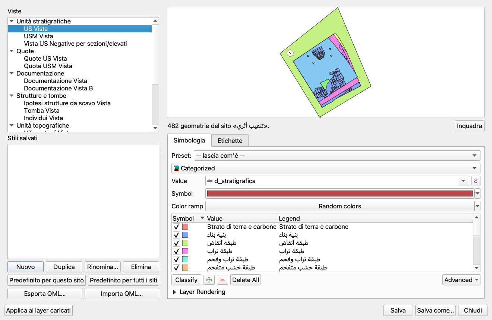

# Tutorial 14: GIS e Cartografia

## Introduzione

PyArchInit e profondamente integrato con **QGIS**, sfruttandone tutte le funzionalita GIS per la gestione spaziale dei dati archeologici. Questo tutorial copre l'integrazione cartografica, i layer predefiniti e le funzionalita avanzate come la **segmentazione automatica SAM**.

### Funzionalita GIS Principali

- Visualizzazione US su mappa
- Layer vettoriali predefiniti
- Styling QML personalizzato
- Quote e misurazioni GIS
- Segmentazione automatica (SAM)
- Export cartografico

## Layer Predefiniti PyArchInit

### Layer Vettoriali Principali

| Layer | Geometria | Descrizione |
|-------|-----------|-------------|
| `pyunitastratigrafiche` | MultiPolygon | US deposito |
| `pyunitastratigrafiche_usm` | MultiPolygon | US murarie |
| `pyarchinit_quote` | Point | Punti quota |
| `pyarchinit_siti` | Point | Localizzazione siti |
| `pyarchinit_ripartizioni_spaziali` | Polygon | Aree di scavo |
| `pyarchinit_strutture_ipotesi` | Polygon | Strutture ipotizzate |
| `pyarchinit_documentazione` | Point | Riferimenti documentazione |

### Attributi Layer US

| Campo | Tipo | Descrizione |
|-------|------|-------------|
| `gid` | Integer | ID univoco |
| `scavo_s` | Text | Nome sito |
| `area_s` | Text | Numero area |
| `us_s` | Text | Numero US |
| `stratigraph_index_us` | Integer | Indice stratigrafico |
| `tipo_us_s` | Text | Tipo US |
| `rilievo_originale` | Text | Rilievo di origine |
| `disegnatore` | Text | Autore rilievo |
| `data` | Date | Data rilievo |

## Visualizzazione US su Mappa

### Dal Tab "Map" nella Scheda US

1. Aprire una scheda US
2. Selezionare il tab **Map**
3. Funzioni disponibili:

| Pulsante | Funzione |
|----------|----------|
| View US | Visualizza US corrente su mappa |
| View All | Visualizza tutte le US dell'area |
| New Record | Crea nuova geometria |
| Pan to | Centra mappa su US |

### Visualizzazione da Ricerca

1. Eseguire una ricerca US
2. Pulsante **"View Record"** → visualizza singola
3. Pulsante **"View All"** → visualizza tutti i risultati

### Scelta dello Stile (US e USM)

Dalla **5.13.112-alpha** la finestra **Scelta Stile** descritta qui sotto compare **solo se per la vista non c'è nessuno stile predefinito salvato**: con un predefinito (per il sito o per tutti i siti) la scheda carica la vista, applica quello e non chiede niente. I predefiniti si creano nella finestra **Stili delle viste** (sezione «Stili delle viste», più sotto).

Quando le US o le USM dei risultati di ricerca vengono caricate sulla mappa compare la finestra **Scelta Stile** ("Come vuoi gestire lo stile del layer?"):

| Pulsante | Effetto |
|----------|---------|
| **Salva nuovo stile** | Crea lo stile in base al campo scelto e lo salva nel database con un nome |
| **Carica stile esistente** | Usa come modello uno stile già pronto, scelto da un elenco (vedi sotto), e crea lo stile in base al campo scelto senza salvarlo nel database |
| **Usa stile temporaneo** | Crea lo stile in base al campo scelto senza salvarlo nel database |
| **Simbolo singolo (solo contorno)** | Disegna solo il contorno delle geometrie, senza riempimento |

Dalla 5.13.19-alpha **Carica stile esistente** apre la finestra **Stile esistente** ("Scegli lo stile da usare come modello:") con l'elenco degli stili disponibili: gli stili salvati nel database (*Database: nome*), gli stili QML forniti con pyArchInit (`us_*.qml`, elencati come *pyArchInit: …*) e **Altro file QML…**, che permette di scegliere un qualsiasi file `.qml`. Lo stile scelto viene caricato sul layer (trasparenza e fusione arrivano con lui; le etichette no: sulle viste US e USM di poligoni sono, dalla 5.13.110-alpha, quelle del paragrafo **Etichette** più sotto, il numero dell'unità cerchiato, qualunque cosa dica lo stile modello) e fa da **modello**: dopo aver scelto il campo di categorizzazione, i valori che lo stile ha già mantengono il suo colore e simbolo, gli altri ricevono una copia del suo simbolo con un proprio colore. Se si annulla la scelta, funziona come **Usa stile temporaneo**. Prima cercava solo tra gli stili del database e, non trovandone, passava direttamente alla finestra di categorizzazione.

Con **Salva nuovo stile**, **Carica stile esistente** e **Usa stile temporaneo** si sceglie poi il campo di categorizzazione (finestra **Selezione Campo per Categorizzazione**): **Definizione Stratigrafica**, **Tipo US**, **Definizione Interpretativa** o **Periodo/Fase (cont_per)** (dalla 5.13.19-alpha); ogni valore del campo riceve un proprio colore, che dalla 5.13.19-alpha resta lo stesso a ogni caricamento del layer. Con **Periodo/Fase (cont_per)** la voce di legenda di ogni codice mostra anche la datazione del periodo/fase presa dalla periodizzazione. Compaiono solo i campi presenti nel layer.

**Ordine di disegno.** Dalla 5.13.19-alpha le unità vengono disegnate nell'ordine usato dal Time Manager: prima quelle senza periodo, poi per cronologia del periodo (dalla periodizzazione del periodo/fase iniziale della US, oppure dal `cont_per`), poi per `order_layer` (0 = più antico) e infine il taglio sopra il suo riempimento, così le unità più recenti stanno sopra. Vale per tutte le opzioni di stile, anche **Simbolo singolo (solo contorno)**. Quando i layer vengono caricati periodo per periodo, lo stile viene chiesto una sola volta e usato per tutti i periodi.

**Etichette.** Dalla 5.13.110-alpha, con lo stile scelto la vista US (e USM) riceve anche le **etichette**: il numero dell'unità in **grassetto dentro un cerchio bianco con il bordo rosso scuro**, **una per unità**, sul suo disegno più grande se si vede (non coperto per intero da uno di livello più alto), con la stessa ricetta delle tavole dell'atlante del Time Manager (tutorial 25). Quando due numeri si coprirebbero, uno viene spostato e una linea di richiamo lo collega al suo disegno. Vale per US e USM, con SQLite e con PostgreSQL, e per tutte le opzioni di stile, anche **Simbolo singolo (solo contorno)**; se lo stile caricato con **Carica stile esistente** aveva già delle etichette, il numero cerchiato prende il loro posto. I layer di punti non ricevono il numero cerchiato. Dalla 5.13.111-alpha, però, la **vista delle quote** (i punti quota, «Quote view»), appena caricata dalla scheda US, porta l'**etichetta con il valore della quota** (due decimali, per esempio «12,35»), posta **sopra la linea orizzontale del simbolo**, con la stessa ricetta delle tavole dell'atlante del Time Manager. Vale per tutte le voci che la caricano, con SQLite e con PostgreSQL, e non dipende dallo stile scelto; i layer che non sono di punti, o che non hanno il campo della quota, non ricevono questa etichetta. Dalla 5.13.112-alpha il numero cerchiato e la quota sono i **preset di partenza** delle etichette: nel tab **Etichette** della finestra **Stili delle viste** (sezione omonima, più sotto) si possono cambiare e salvare come stile predefinito, che al caricamento prende il loro posto.

Dalla 5.13.18-alpha lo stile scelto (e il campo di categorizzazione) viene rispettato anche con i database SQLite, sia per le US sia per le USM; prima la mappa usciva sempre con un colore per ogni US.

## Stili delle viste

Dalla versione **5.13.112-alpha** una sola finestra, **Stili delle viste**, serve a comporre lo stile — **simbologia ed etichette** — di ogni vista di pyArchInit: le viste delle US e delle USM, le quote, la documentazione, le strutture e le tombe, le UT, i siti, i reperti, le sezioni. Lo stile si vede subito su un'**anteprima** con i dati del sito, si salva con un nome nel database e si può rendere **predefinito** per un sito o per tutti: da quel momento le schede che caricano la vista lo applicano da sole, senza chiedere niente.

<!-- IMMAGINE: Screenshot della finestra «Stili delle viste»: a sinistra l'elenco delle viste e degli stili salvati con i loro bottoni; a destra l'anteprima e i tab Simbologia ed Etichette; in basso Applica ai layer caricati, Salva, Salva come… e Chiudi -->

*Figura 1: La finestra «Stili delle viste»*

I testi della finestra sono in italiano se QGIS è in italiano, in inglese con tutte le altre lingue.

### Da dove si apre

La finestra non è modale: resta aperta mentre si lavora sulla mappa. Si apre in quattro modi.

- **Dalla toolbar di pyArchInit** (dalla 5.13.113-alpha): il **quarto bottone**, con l'icona della tavolozza, subito dopo quello di GPT («AI Query Database»). Se il layer attivo è una vista di pyArchInit la finestra si apre già su quella vista, altrimenti sulla vista US.
- **Dal menu del plugin**: **Plugins → pyArchInit - Archaeological GIS Tools → Stili delle viste…** («Stili delle viste…» con QGIS in italiano, «View styles…» con le altre lingue). Se il layer attivo è una vista di pyArchInit la finestra si apre già su quella vista, altrimenti sulla vista US.
- **Dal menu del layer**: tasto destro su un layer vettoriale nel pannello dei layer di QGIS → **Stili delle viste…**. È la stessa voce, con lo stesso nome e la stessa regola: se il layer è una vista di pyArchInit la finestra si apre già su quella.
- **Dalla scheda US**: il bottone **Stile…** (*Style…* con QGIS in una lingua diversa dall'italiano), accanto al bottone che carica i layer. Apre la finestra sulla vista US, con il sito della scheda.

L'anteprima mostra le geometrie di un **sito**: quello della scheda se la finestra si apre dal bottone «Stile…», altrimenti il **sito attivo** impostato nella configurazione di pyArchInit (tutorial 01). Senza un sito attivo mostra tutti i siti.

### Le viste e gli stili salvati

La colonna di sinistra ha due elenchi.

**Viste.** Le viste di pyArchInit, a gruppi:

| Gruppo | Viste |
|--------|-------|
| Unità stratigrafiche | US, USM, US negative |
| Quote | quote US, quote USM |
| Documentazione | documentazione (due viste) |
| Strutture e tombe | strutture, tombe, individui |
| Unità topografiche | UT puntuali, lineari, poligonali |
| Siti | siti puntuali, siti poligonali |
| Reperti | reperti |
| Sezioni | sezioni di scavo |

Anche le viste che finora si caricavano senza stile (documentazione, strutture e tombe, UT, siti, reperti, sezioni) ne hanno uno qui. Una vista che non c'è nel database diventa **grigia** quando la scegli, e la riga di stato dice «Vista non presente in questo database.».

**Stili salvati.** Sotto, gli stili salvati per la vista scelta, uno per riga: *nome · sito (o «tutti i siti») · «✓ predefinito»*. Un clic su uno stile lo carica nell'anteprima e nei pannelli, per guardarlo o ritoccarlo. Gli stili che QGIS ha salvato nel database per quel layer compaiono come *nome · Salvato con QGIS*: si possono caricare, ma pyArchInit non li riscrive; per tenerne una copia fra i suoi stili si usa **Salva come…**. I bottoni sotto l'elenco:

| Bottone | Che cosa fa |
|---------|-------------|
| **Nuovo** | Parte da uno stile da comporre: solo contorno, con le etichette di partenza della vista. Il nome si chiede al primo **Salva** |
| **Duplica** | Copia lo stile scelto, col nome «… (2)»; la copia non è predefinita |
| **Rinomina…** | Cambia il nome dello stile scelto |
| **Elimina** | Elimina lo stile scelto, dopo una conferma |
| **Predefinito per questo sito** | Lo stile scelto diventa quello che si applica al caricamento della vista per il sito corrente (se lo stile è di «tutti i siti», ne fa una copia per il sito corrente e rende predefinita la copia; l'originale resta com'è) |
| **Predefinito per tutti i siti** | Diventa quello che si applica ai siti che non hanno un predefinito proprio (se lo stile è di un sito, ne fa una copia per tutti i siti e rende predefinita la copia; l'originale resta com'è) |
| **Esporta QML…**, **Importa QML…** | Vedi «Esportare e importare» |

Per ogni vista c'è un solo predefinito per ciascun sito e uno solo per tutti i siti: renderne predefinito un altro toglie il segno «✓ predefinito» al precedente. Duplica, Rinomina, Elimina e i due Predefinito agiscono sullo stile scelto nell'elenco; se non ne è scelto nessuno compare l'avviso «Scegli prima uno stile salvato.».

### Anteprima, simbologia ed etichette

**Anteprima.** In alto a destra una mappa mostra la vista scelta, letta dal database e filtrata sul sito corrente: ogni modifica allo stile si vede subito. **Inquadra** (*Zoom to data*) porta la mappa su tutte le geometrie. La riga di stato sotto la mappa dice quante sono (*482 geometrie del sito «Scavo 2026».*) o, se il sito non ne ha in quella vista, «Nessuna geometria per il sito corrente.»: lo stile si può comporre lo stesso. L'anteprima è un layer a parte, **non aggiunto al progetto**: i layer del progetto di QGIS non cambiano finché non si preme **Applica ai layer caricati**. Quando si sceglie una vista l'anteprima parte da quello che pyArchInit applicherebbe in quel momento al caricamento (vedi «Predefiniti e caricamento»).

Sotto la mappa ci sono due tab: **Simbologia** ed **Etichette**.

**Tab Simbologia.** In alto la tendina **Preset**:

| Preset | Effetto |
|--------|---------|
| *— lascia com'è —* | Non cambia niente |
| *Solo contorno* | Poligoni senza riempimento e con il bordo grigio scuro, linee sottili, punti come cerchietti vuoti |
| *Stile fornito con pyArchInit* | Il QML che accompagna il plugin: c'è per le viste US e USM e per le quote |
| *Categorie per «campo»* | Una categoria, con il suo colore, per ogni valore del campo. C'è una voce per ognuno dei campi sensati per quella vista che il layer possiede: per le unità `d_stratigrafica`, `tipo_us_s`, `d_interpretativa` e `cont_per`; per le altre viste, per esempio, `tipo_doc`, `tipologia_struttura` o `tipo_reperto` |

Sotto la tendina c'è l'**editor di simbologia di QGIS**, lo stesso delle proprietà del layer (simbolo singolo, categorizzato, graduato, a regole…): il preset è il punto di partenza e da lì si ritocca tutto; ogni modifica si vede subito nell'anteprima.

**Tab Etichette.**

| Controllo | Che cosa fa |
|-----------|-------------|
| **Etichette attive** | Accende e spegne le etichette della vista |
| **Che cosa scrivere** | *Nessuna etichetta*; *Numero dell'unità in un cerchio* (il numero in grassetto dentro un cerchio bianco con il bordo rosso scuro, come sulle tavole dell'atlante del Time Manager, tutorial 25); *Quota sopra il simbolo* (il valore della quota sopra la linea orizzontale del simbolo); *Un campo o un'espressione* |
| **Campo**, **Espressione** | Per l'ultima voce: il campo della vista da scrivere o un'espressione di QGIS (se è scritta, ha la precedenza sul campo) |
| **Posizione**, **Scostamento (mm)** | Per l'ultima voce: *Al centro*, *Intorno al punto* o *Sopra il simbolo*; lo scostamento alza l'etichetta di tanti millimetri e vale per *Sopra il simbolo* |
| **Una etichetta per unità (sul disegno più grande che si vede)** | Per il numero dell'unità: una sola etichetta per unità, sul suo disegno più grande che si vede (non coperto per intero da uno di livello più alto); spenta, ogni disegno ha la sua |
| **Carattere e sfondo** | Carattere, **Corpo (mm)**, **Grassetto**, **Colore…** del testo, **Alone bianco**, **Sfondo a cerchio** con **Riempimento…** e **Bordo…** |

Il numero dell'unità in un cerchio è il preset di partenza delle viste US e USM, la quota sopra il simbolo quello delle viste delle quote: sono le etichette del paragrafo **Etichette** della «Scelta dello Stile (US e USM)» (sopra), che qui si possono cambiare. Le altre viste, di partenza, non hanno etichette. Il pannello è quello di pyArchInit, più semplice dell'editor delle etichette di QGIS (a regole e così via), che non si può aprire fuori dalle proprietà del layer.

### Predefiniti e caricamento

In basso ci sono quattro bottoni:

| Bottone | Che cosa fa |
|---------|-------------|
| **Applica ai layer caricati** | Applica lo stile che si vede nell'anteprima — simbologia ed etichette — ai layer del progetto di QGIS che vengono da quella vista; la riga di stato dice «Stile applicato a N layer del progetto.» o «Nessun layer di questa vista nel progetto.». Non salva niente nel database |
| **Salva** | Salva sullo stile corrente (quello scelto nell'elenco); se non ce n'è nessuno, chiede il nome e crea uno stile nuovo |
| **Salva come…** | Chiede il nome e salva uno stile nuovo, per tutti i siti: *Stile «nome» salvato.* |
| **Chiudi** | Chiude la finestra |

Per far diventare uno stile quello che si vede a ogni caricamento: (1) scegli la vista; (2) componi simbologia ed etichette guardando l'anteprima; (3) **Salva come…** con un nome; (4) **Predefinito per questo sito** oppure **Predefinito per tutti i siti**; (5) se i layer sono già nel progetto, **Applica ai layer caricati**.

**Al caricamento comanda il predefinito.** Quando una scheda di pyArchInit (per esempio la scheda US) carica una vista, applica nell'ordine:

1. lo stile **predefinito del sito per cui si carica la vista** (se c'è): la scheda US passa il sito della scheda, i caricatori per periodo (Time Manager) il sito che stanno disegnando; dove il caricatore non conosce il sito vale il sito attivo della configurazione di pyArchInit (tutorial 01);
2. altrimenti lo stile **predefinito per tutti i siti**;
3. altrimenti, per le viste US, USM e delle quote, lo stile fornito con pyArchInit con il numero cerchiato o la quota sopra il simbolo (come dalla 5.13.110-alpha e dalla 5.13.111-alpha); le altre viste si caricano come prima, senza stile.

La finestra in tre passi **Scelta Stile** (paragrafo «Scelta dello Stile (US e USM)», sopra) compare **solo se per quella vista non c'è nessuno stile predefinito salvato**; con un predefinito la scheda US carica e basta, e uno stile scelto a mano non lo sovrascrive. «Una etichetta per unità» si ricalcola a ogni caricamento, sui disegni del filtro di quel momento: non dipende da quello con cui lo stile fu salvato. Anche il tab **Map preview** della scheda US rispetta il predefinito salvato (con SQLite dalla 5.13.113-alpha, prima dava un errore; con PostgreSQL già dalla 5.13.112-alpha); senza predefinito mostra come prima la sua simbologia automatica, e anche lì i poligoni restano in ordine stratigrafico.

**L'ordine di disegno è sempre quello stratigrafico** (dalla 5.13.113-alpha). Sulle viste delle unità (US, USM, US negative) i poligoni si disegnano dal più antico, sotto, al più recente, sopra: prima i periodi per cronologia, se la periodizzazione del sito si legge (le unità senza periodo per prime), poi `order_layer` crescente (0 = la più antica, disegnata per prima), poi l'indice stratigrafico, come nel Time Manager (tutorial 25). Vale qualunque sia lo stile — il predefinito salvato, il QML fornito, un QML importato, lo stile composto nell'anteprima — anche in **Applica ai layer caricati** e nell'anteprima della finestra. Così, togliendo il segno di spunta a una categoria nella legenda di QGIS, si vede quello che sta sotto. Le altre viste (quote, documentazione, strutture…) non prendono nessun ordine.

### Esportare e importare

- **Esporta QML…** scrive in un file `.qml` lo stile come si vede nell'anteprima — simbologia ed etichette —; il nome proposto è quello della vista (per esempio `pyarchinit_us_view.qml`). Serve per tenerne una copia o per usarlo in un altro database o in QGIS.
- **Importa QML…** legge un file `.qml`, lo mostra nell'anteprima e lo salva come stile nuovo, per tutti i siti, con il nome del file. Se il file non si legge come QML un avviso lo dice col nome del file (*Il file «nome.qml» non si legge come QML.*) e non viene scritto niente.
- Gli stili salvati stanno nel **database collegato** a pyArchInit, nella tabella `pyarchinit_view_styles`, che si crea da sola, con SQLite e con PostgreSQL: con PostgreSQL li vedono tutti gli utenti dello stesso database. Per passarli a un altro database si esportano e si importano come QML.
- Se il database non è collegato (o la tabella degli stili non si può creare, per esempio su PostgreSQL senza il permesso di creare tabelle) gli stili salvati non sono disponibili e si può solo esportare: la riga di stato sotto l'anteprima lo dice dopo il conteggio delle geometrie, con «Database non collegato: gli stili si possono solo esportare.» oppure «La tabella degli stili non si può creare in questo database: gli stili si possono solo esportare.» (in inglese: “Database not connected: styles can only be exported.” / “The styles table cannot be created in this database: styles can only be exported.”).

## Styling dei Layer

### File QML

PyArchInit include stili predefiniti in formato QML:
```
pyarchinit/styles/
├── pyunitastratigrafiche.qml
├── pyunitastratigrafiche_usm.qml
├── pyarchinit_quote.qml
└── ...
```

### Applicazione Stile

1. Selezionare il layer in legenda
2. Tasto destro → **Proprieta**
3. Tab **Stile**
4. **Carica stile** → selezionare QML

### Personalizzazione

Gli stili possono essere personalizzati per:
- Colori in base al tipo US
- Etichette con numero US
- Trasparenza
- Bordi e riempimenti

## Quote e Misurazioni

### Layer Quote

Il layer `pyarchinit_quote` memorizza:
- Coordinate X, Y
- Quota Z (assoluta)
- Tipo punto quota
- US di riferimento
- Area di riferimento

### Calcolo Quote Automatico

Dalla Scheda US, le quote min/max vengono calcolate:
1. Query ai punti quota associati all'US
2. Estrazione valore minimo e massimo
3. Visualizzazione nel report

### Inserimento Quote

1. Layer quote in editing
2. Disegnare punto sulla mappa
3. Compilare attributi:
   - `sito_q`
   - `area_q`
   - `us_q`
   - `quota`
   - `unita_misura_q`

## Segmentazione Automatica SAM

### Cos'e SAM?

**SAM (Segment Anything Model)** è il modello di intelligenza artificiale di Meta che divide un'immagine nei suoi oggetti. In pyArchInit la finestra SAM trasforma un'immagine in **poligoni**, partendo da:

- un'**ortofoto** (un file raster: GeoTIFF, JPEG georeferenziato…);
- oppure un **layer di tile o un servizio** caricato in QGIS: XYZ come ESRI World Imagery o Google, WMS, ArcGIS REST.

Non solo pietre: anche **edifici, strade, campi, fiumi, muri**. I modelli sono di due famiglie:

- **SAM 2.1** (Meta) trova i contorni degli oggetti — tutti, oppure quelli che indichi con punti, un riquadro o un poligono — ma non dice che cosa sono;
- le **classi a testo** (YOLOE-26 in locale, SAM 3 in cloud) cercano le cose che scrivi («building, road, river, field») e ogni poligono porta la sua etichetta.

I poligoni vanno nel layer che scegli: i layer US di pyArchInit, un qualsiasi layer poligonale del progetto o un layer temporaneo nuovo.

### Accesso alla Funzione

1. Dalla toolbar di pyArchInit: pulsante a tendina **Strumenti di Analisi** (Analysis Tools) → «SAM - Segmentazione (pietre, edifici, strade, campi…)». È l'azione predefinita del pulsante: un clic sull'icona apre subito la finestra.
2. Oppure dal menu **pyArchInit** → «SAM - Segmentazione (pietre, edifici, strade, campi…)».

La finestra si intitola «SAM — Segmentazione (pietre, edifici, strade, campi, fiumi…)». Le sue etichette sono in italiano se QGIS è in italiano, in inglese con tutte le altre lingue.

### Interfaccia SAM

```
┌────────────────────────────────────────────────────────────────────┐
│ SAM — Segmentazione (pietre, edifici, strade, campi, fiumi…)       │
├────────────────────────────────────────────────────────────────────┤
│ Segmentazione automatica — da un'ortofoto o da un layer di tile    │
│ (ESRI, Google, WMS) a poligoni, con SAM 2.1 (Meta) o con classi    │
│ a testo.                                                           │
├─ Ambiente locale ──────────────────────────────────────────────────┤
│ pronto — ultralytics 8.4.x, torch 2.x, mps                         │
│                           [Installa / aggiorna]  [Mostra registro] │
├─ Immagine ─────────────────────────────────────────────────────────┤
│ Layer raster: [ortofoto.tif                                   v]   │
│               ortofoto.tif — 12000 × 9000 px                       │
│ Area:         (o) vista corrente   ( ) tutto il raster             │
│ Risoluzione (unità mappa/px): [0,100000]                           │
│ Lato massimo (px):            [2048]                               │
├─ Che cosa segmentare ──────────────────────────────────────────────┤
│ (o) Tutto automatico (ogni oggetto)                                │
│ ( ) Punti: clicca gli oggetti sulla mappa                          │
│ ( ) Riquadro: disegna un rettangolo                                │
│ ( ) Poligono: disegna l'area                                       │
│ ( ) Poligono da layer: [layer poligonale                      v]   │
│ ( ) Classi a testo:    [building, road, river, field           ]   │
│ Soglia: [0,30]                                                     │
├─ Modello ──────────────────────────────────────────────────────────┤
│ Modello: [Locale: SAM 2.1 Tiny — ~78 MB                       v]   │
│          pesi presenti ✓                          [Scarica pesi]   │
│ Chiave API: [••••••••]                         Chiave Replicate    │
├─ Destinazione ─────────────────────────────────────────────────────┤
│ Layer: [pyunitastratigrafiche                                 v]   │
│ Sito: [Scavo 2026]                Area: [1]                        │
│ Indice stratigrafico: [1]         Tipo US: [pietra            v]   │
│ Campo per l'etichetta: [label                                 v]   │
├────────────────────────────────────────────────────────────────────┤
│ Pronto                                                             │
│                                      [Avvia]  [Annulla]  [Chiudi]  │
└────────────────────────────────────────────────────────────────────┘
```

Cinque gruppi, da compilare dall'alto in basso: «Ambiente locale», «Immagine», «Che cosa segmentare», «Modello», «Destinazione». Sotto ci sono la riga di stato («Pronto»), dove scorrono anche i messaggi del lavoro in corso, e i pulsanti «Avvia», «Annulla» (compare solo durante il lavoro) e «Chiudi». Alcune righe compaiono solo quando servono: «Chiave API:» al posto dello stato dei pesi per i modelli cloud; «Sito:», «Area:», «Indice stratigrafico:» e «Tipo US:» per i layer US; «Campo per l'etichetta:» per gli altri layer. La finestra ricorda l'ultima area US, le classi, il lato massimo, il modello scelto e le chiavi API.

#### Ambiente locale

I modelli locali (SAM 2.1 e YOLOE) non girano nel Python di QGIS ma in un **Python separato**, che la finestra crea e controlla da sola. All'apertura il gruppo scrive «controllo…», poi:

- in verde «pronto — ultralytics …, torch …, mps»: l'ambiente c'è; l'ultima parola è il dispositivo di calcolo (`mps`, `cuda` o `cpu`);
- in arancione «non installato: serve per i modelli locali (SAM 2.1, YOLOE). Un Python 3.10–3.13 di sistema, ~1.5 GB di pacchetti.».

«Installa / aggiorna» crea l'ambiente o ne aggiorna i pacchetti (vedi più avanti «Installazione Locale SAM»); «Mostra registro» apre e chiude il registro dell'installazione, con l'uscita di pip riga per riga. Per i modelli cloud l'ambiente non serve.

#### Immagine

- «Layer raster:» l'immagine da segmentare, scelta tra i raster del progetto: un'ortofoto (file) o un layer di tile/servizio. Sotto, in grigio, è scritto quale dei due è: nome del file e dimensioni in pixel (`ortofoto.tif — 12000 × 9000 px`) oppure il tipo di servizio, reso dalla vista (`tile / WMS (reso dalla vista)`, `ArcGIS REST (reso dalla vista)`).
- «Area:» «vista corrente» (quello che si vede nella mappa) oppure «tutto il raster». «tutto il raster» si può scegliere solo per i file: un servizio di tile non ha un bordo, si lavora sempre sulla vista (o su un riquadro o un poligono).
- «Risoluzione (unità mappa/px):» solo per i tile: quante unità di mappa (metri, o gradi se la mappa è in coordinate geografiche) per ogni pixel dell'immagine resa. Il valore proposto è quello della vista quando apri la finestra o scegli il layer: se poi cambi zoom, correggilo a mano. Più è piccolo, più dettagli.
- «Lato massimo (px):» il lato più lungo dell'immagine passata al modello: 2048 di base, da 512 a 8192. Oltre questo lato l'immagine viene ridotta; SAM lavora comunque a 1024 px interni.

### Modalita di Segmentazione

Il gruppo «Che cosa segmentare» offre sei modi. Scegliendo un modo cambia l'elenco dei modelli (vedi «Modelli Disponibili») e sotto compare, in blu, l'istruzione per quel modo.

#### 1. Tutto automatico

«Tutto automatico (ogni oggetto)»: SAM 2.1 segmenta ogni oggetto che trova nell'«Area:» scelta («vista corrente» o «tutto il raster»). I poligoni non hanno una classe: nel layer temporaneo prendono l'etichetta «segmento». Si parte con «Avvia».

#### 2. Punti

«Punti: clicca gli oggetti sulla mappa»: premi «Avvia la selezione»; la finestra si nasconde e la barra dei messaggi di QGIS ricorda i comandi. Clicca gli oggetti uno per uno: ogni clic è un oggetto. Tasto destro o Invio per finire, Backspace toglie l'ultimo punto, Esc annulla. La finestra riappare e la segmentazione parte sull'«Area:» scelta, un oggetto per punto; i punti fuori dall'immagine vengono ignorati.

#### 3. Riquadro

«Riquadro: disegna un rettangolo»: premi «Avvia la selezione» e trascina un rettangolo sulla mappa (Esc o tasto destro annulla). L'immagine viene ritagliata sul rettangolo e tutto quello che c'è dentro viene segmentato.

#### 4. Poligono

«Poligono: disegna l'area»: premi «Avvia la selezione» e clicca i vertici; tasto destro, Invio o doppio clic chiudono il poligono (servono almeno tre vertici), Backspace toglie l'ultimo vertice, Esc annulla. Si segmenta solo dentro il poligono.

#### 5. Poligono da layer

«Poligono da layer:» scegli un layer poligonale nella tendina accanto. Si usa la geometria selezionata nel layer, o tutte se nessuna è selezionata (più geometrie vengono unite in una). Come per il poligono disegnato, si segmenta solo all'interno: utile per lavorare dentro un saggio, un'area di scavo o un limite già disegnato. Si parte con «Avvia».

#### 6. Classi a testo

«Classi a testo:» scrivi nel campo accanto che cosa cercare: parole **inglesi** separate da virgola (di base «building, road, river, field»; altri esempi: stone, wall). Ogni classe diventa un'etichetta sui poligoni. Funziona con YOLOE-26 in locale o con SAM 3 di Roboflow in cloud, sull'«Area:» scelta. Si parte con «Avvia».

**«Soglia:»** (0,30 di base, da 0,05 a 0,95) è la confidenza minima perché un risultato venga tenuto: più bassa dà più poligoni, anche incerti; più alta ne dà meno ma più sicuri. Il modello cloud Replicate non la usa.

### Modelli Disponibili

Il gruppo «Modello» ha una tendina «Modello:» il cui contenuto dipende dal modo scelto:

| Modello | Tipo | Requisiti | Modi |
|---------|------|-----------|------|
| SAM 2.1 Tiny | Locale | ambiente locale + pesi ~78 MB | tutti tranne le classi a testo; il più leggero e veloce |
| SAM 2.1 Small | Locale | ambiente locale + pesi ~92 MB | tutti tranne le classi a testo |
| SAM 2.1 Base+ | Locale | ambiente locale + pesi ~162 MB | tutti tranne le classi a testo |
| SAM 2.1 Large | Locale | ambiente locale + pesi ~449 MB | tutti tranne le classi a testo; il più preciso e il più lento |
| Cloud: Replicate SAM-2 | Cloud | chiave API Replicate | solo segmentazione automatica (nel modo «Punti» i clic vengono ignorati, con un avviso) |
| YOLOE-26 S | Locale | ambiente locale + pesi ~31 MB + MobileCLIP2 254 MB (una volta) | classi a testo |
| YOLOE-26 M | Locale | ambiente locale + pesi ~70 MB + MobileCLIP2 254 MB (una volta) | classi a testo |
| YOLOE-26 L | Locale | ambiente locale + pesi ~79 MB + MobileCLIP2 254 MB (una volta) | classi a testo |
| Cloud: Roboflow SAM 3 | Cloud | chiave API Roboflow | classi a testo |

Nella tendina le voci si leggono così: «Locale: SAM 2.1 Tiny — ~78 MB», «Locale: YOLOE-26 S (classi a testo) — ~31 MB + MobileCLIP2 254 MB», «Cloud: Replicate SAM-2 (solo automatico, chiave API)», «Cloud: Roboflow SAM 3 (classi a testo, chiave API)».

**Pesi.** Per un modello locale, sotto la tendina c'è lo stato dei pesi: «pesi presenti ✓» (verde) oppure «pesi mancanti (~N MB)» (arancione), con il pulsante «Scarica pesi». Lo scaricamento, con la barra di avanzamento, prende i file dagli asset pubblici di ultralytics su GitHub (non serve un account). Per YOLOE si scarica anche il codificatore di testo MobileCLIP2 (254 MB), una volta sola per S, M e L. I pesi stanno in `~/pyarchinit_5/bin/models/sam/`.

**Chiave API.** Per un modello cloud, al posto dello stato dei pesi compaiono il campo «Chiave API:» e il link per ottenerla (vedi «Configurazione API»).

### SAM-3 con Text Prompt

Con il modo «Classi a testo» non si chiede «dividi tutto», ma «trova queste cose»:

- si scrivono una o più classi in inglese, separate da virgola: `building, road, river, field`, oppure `stone, wall`…;
- **YOLOE-26** (locale, S/M/L) capisce le parole grazie al codificatore di testo MobileCLIP2; **SAM 3** di Roboflow (cloud) riceve le stesse classi come prompt testuali (al massimo 16);
- ogni poligono porta la classe che l'ha trovato: nel layer temporaneo nel campo `label`, in un tuo layer nel «Campo per l'etichetta:». Nei layer US di pyArchInit la classe non viene scritta.

SAM 2.1 in «Tutto automatico» invece non assegna classi: trova i contorni, non i nomi.

### Configurazione API

Le chiavi servono solo per i modelli cloud. Scegli il modello cloud nella tendina, incolla la chiave nel campo «Chiave API:» (il testo resta nascosto) e premi «Avvia»: la chiave viene salvata nelle impostazioni di QGIS e riproposta la volta dopo. Con i modelli cloud l'immagine preparata viene inviata al servizio.

#### Replicate API (SAM-2)
1. Creare un account su [replicate.com](https://replicate.com)
2. Creare un token in [replicate.com/account/api-tokens](https://replicate.com/account/api-tokens) (il link «Chiave Replicate» accanto al campo apre la stessa pagina)
3. Incollarlo in «Chiave API:» con il modello «Cloud: Replicate SAM-2»

#### Roboflow API (SAM-3)
1. Creare un account su [roboflow.com](https://roboflow.com)
2. Copiare la chiave da [app.roboflow.com/settings/api](https://app.roboflow.com/settings/api) (link «Chiave Roboflow» accanto al campo)
3. Incollarla in «Chiave API:» con il modello «Cloud: Roboflow SAM 3»

### Installazione Locale SAM

Non serve nessun comando da terminale: l'ambiente per i modelli locali si installa dalla finestra.

1. Serve un **Python di sistema 3.10–3.13**: i pacchetti non vengono installati nel Python di QGIS, per non rischiare di romperlo. La finestra lo cerca da sola: su **macOS** il Python di [python.org](https://www.python.org/downloads/) o di Homebrew, su **Windows** il launcher `py` del Python di python.org, su **Linux** `python3.10`…`python3.13` o `python3` del sistema.
2. Premere «Installa / aggiorna» nel gruppo «Ambiente locale»: viene creato l'ambiente virtuale `~/pyarchinit_5/bin/sam_venv` e vi vengono installati `ultralytics` (che porta con sé torch, torchvision, OpenCV, numpy) e `requests`: circa **1,5 GB** di pacchetti, una volta sola. Su Linux senza scheda NVIDIA si installa torch per CPU, molto più leggero.
3. «Mostra registro» fa vedere pip al lavoro. Alla fine lo stato diventa verde: «pronto — ultralytics …, torch …, mps».
4. Scaricare i pesi del modello che si vuole usare con «Scarica pesi» (gruppo «Modello»).

Premendo di nuovo «Installa / aggiorna» si aggiornano i pacchetti. Il dispositivo di calcolo si sceglie da solo: **MPS** sui Mac con Apple Silicon, **CUDA** con una scheda NVIDIA, altrimenti **CPU** (funziona, ma è più lento). Se MPS o CUDA falliscono, il lavoro riparte da solo sulla CPU.

| Che cosa | Dove |
|----------|------|
| Ambiente Python | `~/pyarchinit_5/bin/sam_venv` |
| Pesi dei modelli | `~/pyarchinit_5/bin/models/sam/` |
| Chiavi API | impostazioni di QGIS |

`~/pyarchinit_5` è la cartella dati di pyArchInit (o quella indicata dalla variabile `PYARCHINIT_HOME`).

### Destinazione e Attributi

Il gruppo «Destinazione» decide dove vanno i poligoni. La tendina «Layer:» elenca i layer poligonali del progetto più «— nuovo layer temporaneo —»; se `pyunitastratigrafiche` è caricato, viene proposto quello.

| Destinazione | Che cosa viene scritto |
|--------------|------------------------|
| «— nuovo layer temporaneo —» | un layer in memoria `SAM_<raster>_<data_ora>`, nel CRS dell'immagine, con i campi `label` (la classe, o «segmento»), `score` (confidenza), `area`, `source` (il modello) e `created` (data e ora) |
| `pyunitastratigrafiche` / `pyunitastratigrafiche_usm` | `scavo_s` = «Sito:» (dalla configurazione, non modificabile), `area_s` = «Area:» (obbligatoria), `stratigraph_index_us` = «Indice stratigrafico:» (1 = pietre/oggetti, 2 = strato/area), `tipo_us_s` = «Tipo US:» (pietra, layer, accumulo, taglio, struttura), `disegnatore` = `SAM <modello>` (es. `SAM sam2.1_t.pt`), `data` = oggi; `us_s` resta vuoto |
| un altro layer poligonale | la classe nel «Campo per l'etichetta:», un campo di testo (viene proposto `label`, `etichetta`, `classe`, `class`, `tipo` o `nome`, se esiste; vuoto = non scrivere); se il layer ha campi `score`, `area`, `source` o `created`, vengono riempiti anche quelli |

- Nei layer US il numero US si assegna dopo, nella tabella degli attributi: il messaggio finale lo ricorda («Poi assegna i numeri US nella tabella degli attributi.»).
- I poligoni vengono riproiettati nel CRS del layer di destinazione e salvati subito nel layer (se il layer era già in modifica, vengono salvate anche le modifiche in sospeso).
- Il layer temporaneo vive solo fino alla chiusura di QGIS: per tenerlo, esportarlo in un file (tasto destro sul layer → Esporta).

### Come Funziona

1. **L'immagine.** Per un file, l'area viene ritagliata e, se serve, ridotta con GDAL: i pixel sono quelli veri del file, non quelli disegnati in mappa (lo stile del layer non conta; i raster che non sono a 8 bit vengono riportati a 0–255). Per tile e servizi non c'è un file: QGIS rende la vista con il suo motore di disegno, alla risoluzione scelta — solo quel layer, senza gli altri layer della mappa — e si segmenta il reso.
2. **L'area.** Con un poligono (disegnato o da layer) si prende il rettangolo che lo contiene, si imbianca tutto quello che sta fuori e alla fine i risultati vengono ritagliati sul poligono.
3. **Il modello.** Il lavoro lo fa `scripts/sam_worker.py`, che gira fuori da QGIS con il Python di `sam_venv` (o chiama il servizio cloud): QGIS non si blocca. I suoi messaggi di avanzamento (le righe `[sam] …` del worker) compaiono nella riga di stato: il modello e il dispositivo, poi quanti poligoni in quanti secondi. I poligoni sotto i 20 pixel vengono scartati e i contorni semplificati.
4. **Il ritorno in mappa.** Il worker restituisce i poligoni in pixel; pyArchInit li riporta in coordinate con la georeferenza dell'immagine, ripara le geometrie non valide e le riproietta nel CRS del layer di destinazione.

### Workflow SAM

**1. Preparazione**
- Caricare l'ortofoto, oppure un layer di tile (es. ESRI World Imagery come XYZ Tiles)
- Verificare il sistema di riferimento del progetto
- Per scrivere nelle US: caricare `pyunitastratigrafiche` (o `pyunitastratigrafiche_usm`) e controllare il sito nella configurazione
- La prima volta, per i modelli locali: «Installa / aggiorna», poi «Scarica pesi»

**2. Configurazione**
- «Immagine»: layer raster, area, risoluzione (per i tile) e lato massimo
- «Che cosa segmentare»: il modo, la soglia e, per le classi a testo, le classi
- «Modello»: un modello locale con i pesi presenti, o un modello cloud con la sua chiave
- «Destinazione»: il layer e i suoi attributi

**3. Esecuzione**
- «Avvia», oppure «Avvia la selezione» e poi punti, riquadro o poligono sulla mappa
- Seguire la riga di stato; «Annulla» interrompe il lavoro
- Alla fine compare `Fatto: N poligoni aggiunti a «layer» (modello).`

**4. Post-elaborazione**
- Controllare i poligoni; eventuali avvisi compaiono nella barra dei messaggi di QGIS
- Layer US: assegnare i numeri US (`us_s`) nella tabella degli attributi
- Correggere, unire o eliminare i poligoni sbagliati con gli strumenti di modifica di QGIS
- Layer temporaneo: esportarlo se va conservato

## Integrazione Cartografica

### Export Dati GIS

Dalla Scheda US, tab Map:
- **Export GeoPackage**: Layer come GPKG
- **Export Shapefile**: Layer come SHP
- **Export GeoJSON**: Layer come JSON

### Import Dati GIS

Importare geometrie esistenti:
1. Caricare layer in QGIS
2. Selezionare feature
3. Usare funzione import

### Geoprocessing

Operazioni spaziali disponibili:
- Buffer
- Intersezione
- Unione
- Differenza
- Centroids

## Best Practices

### 1. Ortofoto

- Risoluzione minima: 1-2 cm/pixel
- Formato: GeoTIFF georeferenziato
- Sistema riferimento: coerente con progetto

### 2. Digitalizzazione

- Usare snap per precisione
- Verificare topologia
- Mantenere consistenza attributi

### 3. SAM Segmentation

- Ortofoto di buona qualità, illuminazione uniforme, buon contrasto tra oggetti e sfondo
- **Ortofoto grandi**: lavorare per vista o per riquadro, non su «tutto il raster». SAM lavora a 1024 px interni e oltre il «Lato massimo (px):» l'immagine viene ridotta: su un'area troppo grande gli oggetti piccoli si perdono
- **Tile**: scegliere un livello di zoom in cui gli oggetti si riconoscono a occhio (es. 0,3–0,6 m/px per edifici e strade). La «Risoluzione (unità mappa/px):» propone quella della vista; se l'area è grande, l'immagine viene ridotta al lato massimo e la risoluzione reale peggiora
- **Classi a testo**: nomi inglesi semplici (building, road, river, field, stone, wall)
- Le classi vengono solo da YOLOE o da SAM 3: SAM 2.1 in «Tutto automatico» trova i contorni ma non assegna classi
- **Hardware**: sui Mac con Apple Silicon si usa MPS, con una scheda NVIDIA CUDA, altrimenti la CPU, più lenta (meglio allora SAM 2.1 Tiny o Small, YOLOE-26 S e aree piccole)
- Verifica a posteriori sempre necessaria

### 4. Organizzazione Layer

- Raggruppare per tipologia
- Usare stili consistenti
- Mantenere ordine in legenda

## Risoluzione Problemi

### Layer Non Visualizzati

**Cause possibili**:
- Estensione errata
- Sistema riferimento diverso
- Filtro attivo

**Soluzioni**:
- Zoom to Layer
- Verificare CRS
- Rimuovere filtri

### SAM Non Funziona

| Messaggio o sintomo | Che cosa fare |
|---------------------|---------------|
| «Ambiente locale» in arancione «non installato…», oppure `L'ambiente locale non è installato: premi «Installa / aggiorna» (o scegli un modello cloud).` | Premere «Installa / aggiorna». Serve un Python di sistema 3.10–3.13; se non c'è, compare `Installazione non riuscita: Nessun Python 3.10–3.13 trovato: installa Python da python.org (o Homebrew) e riprova.` Se pip fallisce, l'errore è in «Mostra registro». Su Linux senza scheda NVIDIA viene installato torch per CPU |
| «pesi mancanti (~N MB)», oppure `I pesi del modello mancano: premi «Scarica pesi».` | Premere «Scarica pesi» (serve la connessione a internet) |
| `Serve la chiave API del servizio.` | Con un modello cloud, incollare la chiave in «Chiave API:» (vedi «Configurazione API») |
| `Nessun poligono trovato: prova un'area più piccola, una soglia più bassa o un altro modello.` | Area più piccola, «Soglia:» più bassa, un altro modello (un SAM 2.1 più grande, o le classi a testo); per i tile, una risoluzione più fine |
| `l'area scelta non copre il raster` | La vista, il riquadro o il poligono cadono fuori dal raster: inquadrare il raster e riprovare |
| `Compila l'area per il layer US.` | Scrivere l'«Area:» nel gruppo «Destinazione» |
| `raster ruotato: non supportato (riproiettalo prima)` | Riproiettare il raster con gdalwarp (menu Raster di QGIS) e usare il nuovo file |
| «Segmentazione fallita» con le ultime righe del worker | Leggere le righe nel messaggio; riprovare con un'area o un «Lato massimo (px):» più piccoli, o con un modello più piccolo |

### Geometrie Corrotte

**Cause possibili**:
- Errori di digitalizzazione
- Import problematico

**Soluzioni**:
- Usare "Fix Geometries"
- Ridisegnare elemento

### Layer caricato ma geometrie non visibili (SQLite)

**Sintomo**:
- Un layer pyArchInit di un database SQLite/SpatiaLite (es. US `pyunitastratigrafiche`, USM, reperti, US negative) si carica e la tabella attributi mostra i record, ma sulla mappa non compare nulla e "Zoom to Layer" non funziona

**Causa**:
- L'indice spaziale (R*Tree) del layer non è aggiornato: i suoi trigger sono andati persi quando una tabella è stata ricreata (es. da vecchi script di aggiornamento dello schema) oppure i dati sono stati importati scavalcandoli
- QGIS sceglie le entità da disegnare tramite quell'indice, quindi restano invisibili
- Coinvolti anche i database creati dal template SQLite tra ottobre 2025 e settembre 2026

**Soluzione (automatica)**:
- Alla connessione a un database SQLite pyArchInit controlla tutti gli indici spaziali (pochi istanti; se il database è sano non scrive nulla) e ricostruisce automaticamente quelli danneggiati
- Dalla versione 5.13.16-alpha lo stesso controllo ripara anche le **viste spaziali** (`pyarchinit_us_view`, `pyarchinit_quote_view`, strutture, reperti, viste UT, ecc.):
  - ogni vista viene agganciata al ROWID della sua tabella geometrica
  - le registrazioni di viste che non esistono più vengono rimosse
  - le viste standard mancanti vengono ricreate
  - le viste UT vengono registrate come viste spaziali
  - le tabelle geometriche senza indice spaziale ne ricevono uno: serve quando il GDAL fornito con QGIS non ha le funzioni SpatiaLite (es. QGIS su macOS), dove senza indice quei layer non disegnavano nulla
- Prima di modificare qualsiasi cosa salva UNA sola copia di backup accanto al database: `<database>.sqlite.pre_spatial_index_repair_<data-ora UTC>`
- L'esito è scritto nel pannello log di QGIS (Visualizza → Pannelli → Messaggi di log, scheda "PyArchInit")

**Cosa fare**:
- Nulla da avviare a mano: il controllo parte automaticamente alla PRIMA connessione a ciascun database in ogni sessione di QGIS (quindi dopo l'aggiornamento del plugin o dopo il riavvio di QGIS)
- Se i layer erano già caricati, rimuoverli e aggiungerli di nuovo (o riaprire il progetto) dopo la riparazione
- Se il log "PyArchInit" segnala che un indice NON è stato riparato (es. SpatiaLite non caricabile), risolvere la causa e riavviare QGIS: il controllo viene ripetuto solo in una nuova sessione
- Il file di backup può essere eliminato dopo aver verificato i layer
- Per ripetere il controllo (es. dopo aver ripristinato un backup) riavviare QGIS
- Nota: in `inventario_materiali_view` il punto del sito è ripetuto per ogni reperto, quindi "Identify" su quel punto mostra uno dei reperti

## Riferimenti

### File Sorgente
- `modules/gis/pyarchinit_pyqgis.py` - Integrazione GIS
- `tabs/Sam_Segmentation_Dialog.py` - Finestra SAM: gruppi, modi, destinazione
- `modules/utility/sam_environment.py` - Ambiente Python separato, pacchetti e pesi
- `modules/gis/sam_raster_source.py` - Immagine da segmentare (ritaglio GDAL o reso della vista) e georeferenza
- `modules/gis/sam_map_tools.py` - Strumenti di mappa per punti, riquadro e poligono
- `scripts/sam_worker.py` - Worker fuori da QGIS: SAM 2.1, YOLOE, Replicate, Roboflow

### Layer
- `pyunitastratigrafiche` - US deposito
- `pyunitastratigrafiche_usm` - US murarie
- `pyarchinit_quote` - Quote

---

## Video Tutorial

### GIS Integration
`[Placeholder: video_gis_integration.mp4]`

**Contenuti**:
- Layer predefiniti
- Visualizzazione US
- Styling e etichette
- Export cartografico

**Durata prevista**: 15-18 minuti

### SAM Segmentation
`[Placeholder: video_sam_segmentation.mp4]`

**Contenuti**:
- Configurazione SAM
- Modalita di segmentazione
- Post-elaborazione
- Best practices

**Durata prevista**: 12-15 minuti

---

*Ultimo aggiornamento: Ottobre 2026*

---

## Animazione Interattiva

Esplora l'animazione interattiva per approfondire questo argomento.

[Apri Animazione Interattiva](../../animations/pyarchinit_image_classification_animation.html)
