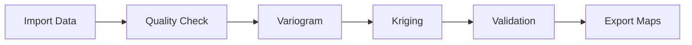

# GeoArchaeo - Advanced Geostatistical Analysis for Archaeological Research

[](https://qgis.org)
[](https://python.org)
[](https://www.gnu.org/licenses/gpl-3.0)
[](https://github.com/enzococca/GeoArchaeo/issues)

**Professional geostatistical system for archaeology** - A complete QGIS plugin for advanced spatial analysis, multivariate kriging, machine learning, and optimal sampling design for archaeological research.

## Key Features

### Geostatistical Analysis
- **Variograms** with weighted model fitting (spherical, exponential, Gaussian, Matérn) and directional anisotropy check
- **Ordinary Kriging** with uncertainty map and leave-one-out cross-validation (RMSE, MAE, ME, R², MSDR)
- **Co-Kriging** (regression + residual kriging), **spatio-temporal kriging** and **batch kriging** in the Processing Toolbox
- **Compositional analysis** (CLR/ILR/ALR transforms)

### Machine Learning
- **Spatial clustering** (K-Means, DBSCAN) and **anomaly detection** (Isolation Forest) in the panel
- **Random Forest** supervised classification (Processing, with a label field)

### GIS Integration
- **Native QGIS Processing Provider**
- **GeoTIFF rasters** (prediction + uncertainty) added to the project
- **Interactive charts** with Plotly (static preview when QtWebEngine is missing)
- **Italian/English interface**, built-in tutorial and example data

### Archaeology-Specific
- **Ceramic analysis** and artifact distribution
- **GPR + Magnetometry fusion**
- **Compositional soil analysis** (CLR/ILR transforms)
- **Optimal sampling design**

## Installation

### Prerequisites

```bash
# Python dependencies
pip install numpy scipy pandas scikit-learn plotly

```

QGIS already ships numpy, scipy and (usually) scikit-learn, plotly and matplotlib; the plugin offers to install
anything missing on first start.

### Method 1: From ZIP (Recommended)

1. Download the latest release: [Download GeoArchaeo.zip](https://github.com/enzococca/GeoArchaeo/releases/latest)
2. In QGIS: `Plugins > Manage and Install Plugins > Install from ZIP`
3. Select the downloaded ZIP file
4. Restart QGIS

### Method 2: From Repository

```bash
# Linux/macOS
cd ~/.local/share/QGIS/QGIS3/profiles/default/python/plugins/
git clone https://github.com/enzococca/GeoArchaeo.git

# Windows
cd %APPDATA%\QGIS\QGIS3\profiles\default\python\plugins\
git clone https://github.com/enzococca/GeoArchaeo.git
```

### Method 3: QGIS Plugin Manager

The plugin is available in the official QGIS Plugin Repository.

## Quick Start

### 1. First Analysis in 5 Minutes

1. Open QGIS and click the GeoArchaeo icon in the toolbar (or load the example data from the panel).
2. At the top of the panel choose the **point layer** and the **numeric field** once: every tab uses them.
3. **Data** tab: statistics and histogram.
4. **Variogram** tab: "Auto" distance, spherical model, *Calculate variogram*.
5. **Kriging** tab: check the grid size shown, *Run kriging* → prediction and uncertainty rasters are added to the map, with cross-validation metrics.
6. **Report** tab: save an HTML report with all the charts.

### 2. Python Console Example

```python
import processing

# Variogram
result = processing.run("geoarchaeo:variogram", {
    'INPUT': 'path/to/points.shp',
    'FIELD': 'ceramic_count',
    'MAX_DISTANCE': 50,
    'MODEL': 0,  # Spherical
    'OUTPUT': 'variogram.json'
})

# Ordinary Kriging
kriging = processing.run("geoarchaeo:ordinarykriging", {
    'INPUT': 'path/to/points.shp',
    'FIELD': 'ceramic_count',
    'PIXEL_SIZE': 2.0,
    'OUTPUT': 'kriging_result.tif'
})
```

## Documentation

### Archaeological Data Format

#### Minimum CSV Format
```csv
id,x,y,type,quantity,period
1,345678.5,4567890.2,ceramic,25,roman
2,345679.1,4567891.7,metal,5,roman
```

**Requirements:**
- Coordinates in a projected CRS (e.g. UTM)
- At least one numeric field for interpolation
- Minimum 30 points for robust analysis

### Typical Workflow



### Use Cases

#### Ceramic Density Analysis
Identify functional areas (kitchens, storage rooms) based on fragment distribution.

#### Geophysical Data Fusion
Combine GPR + Magnetometry to identify buried structures.

#### Compositional Analysis
CLR/ILR transforms for granulometric and chemical soil data.

#### Excavation Optimization
Calculate optimal positions for new test trenches by minimizing uncertainty.

## Sample Datasets

The repository includes sample datasets for testing:

```
test_layers/
├── villa_ceramica.gpkg       # 500 points - ceramic distribution (EPSG:32633)
├── geofisica_survey.gpkg     # 4800 points - GPR + magnetometry
├── necropoli.gpkg            # 120 tombs with attributes
├── soil_samples.gpkg         # 80 points - compositional analysis
├── area_studio.geojson       # study-area polygon for sampling design
└── *.csv                     # the same data and extra surveys as CSV (x, y columns)
```

Use **Load example data** in the panel (or the toolbar button) to add them to the project.

## Development

### Project Structure

```
geoarchaeo/
├── __init__.py                 # Entry point
├── geoarchaeo_plugin.py        # Main plugin class
├── processing_provider.py      # Processing algorithms
├── compat.py                   # Qt5/Qt6 compatibility
├── i18n.py                     # Internationalization (IT/EN)
├── core/
│   └── geostat_engine.py       # Geostatistical engine (QGIS-independent, vectorised)
├── gui/
│   ├── main_dock.py            # Dock widget interface
│   └── tutorial_html.py        # Built-in tutorial (IT/EN)
├── tests/                      # pytest suite (engine + headless QGIS)
├── icons/                      # Icons and resources
├── doc/                        # Documentation
├── test_layers/                # Sample datasets
└── metadata.txt                # QGIS metadata
```

### Running the tests

```bash
# engine only (any Python with numpy/scipy/scikit-learn)
python -m pytest tests/test_engine.py
# full suite with the QGIS Python (macOS example)
/Applications/QGIS.app/Contents/MacOS/bin/python3 -m pytest tests/
```

### Contributing

Contributions are welcome! To contribute:

1. Fork the repository
2. Create a branch (`git checkout -b feature/AmazingFeature`)
3. Commit your changes (`git commit -m 'Add AmazingFeature'`)
4. Push to the branch (`git push origin feature/AmazingFeature`)
5. Open a Pull Request

## Citation

If you use GeoArchaeo in your research, please cite:

```bibtex
@software{geoarchaeo2024,
  author = {Cocca, Enzo},
  title = {GeoArchaeo: Advanced Geostatistical Analysis for Archaeological Research},
  year = {2024},
  publisher = {GitHub},
  url = {https://github.com/enzococca/GeoArchaeo}
}
```

## Support

- **Bug reports**: [Open an issue](https://github.com/enzococca/GeoArchaeo/issues/new)
- **Email**: [enzo.ccc@gmail.com](mailto:enzo.ccc@gmail.com)

## License

This project is licensed under the **GNU General Public License v3.0** - see the [LICENSE](LICENSE) file for details.

## Acknowledgements

- **QGIS Development Team** for the excellent platform
- **Archaeological community** for feedback and testing

## Project Status

- [x] Complete geostatistical core
- [x] Processing integration
- [x] Basic Machine Learning
- [x] Full documentation
- [x] Plugin in official QGIS repository
- [x] Bilingual GUI (IT/EN)
- [ ] More languages (ES/FR)
- [ ] Video tutorials
- [ ] Online workshops

## Useful Links

- **Repository**: [github.com/enzococca/GeoArchaeo](https://github.com/enzococca/GeoArchaeo)
- **Issues**: [Bug Reports](https://github.com/enzococca/GeoArchaeo/issues)
- **QGIS**: [qgis.org](https://qgis.org)

---

<div align="center">

**Developed for the archaeological community by [Enzo Cocca](mailto:enzo.ccc@gmail.com)**

[](https://github.com/enzococca)
[](https://github.com/enzococca/GeoArchaeo)

</div>
